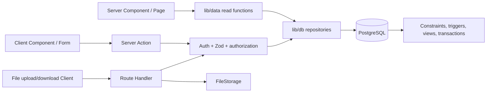
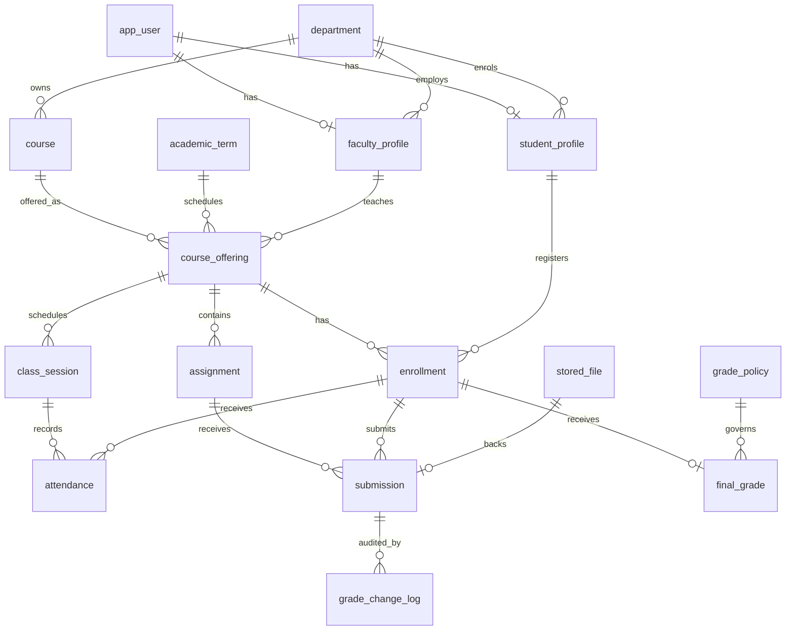

# Implementation Contract — AcadFlow Academic Course Management System

| Field | Value |
|---|---|
| Version | 1.0 — draft for sign-off |
| Date | 2026-11-16 |
| Owner | Lead Software Architect |
| Audience | Codex (database/backend), Cline (frontend), project owner/instructor |
| Status | Binding once the decisions in §3 are signed off. Sections marked **BLOCKED** must not be implemented until their decision is closed. |
| Source documents | `docs/architecture.md`, `docs/DESIGN.md`, `docs/planning.md`, `docs/FEATURES.md`, `docs/image.png` |

This document resolves technical ambiguity. It does not replace the four source documents. Where this contract and a source document disagree on product intent, stop and escalate to the Lead Architect. Where they disagree on implementation detail, this contract wins.

Normative words: **MUST** is mandatory, **SHOULD** is expected unless a documented reason exists, **MAY** is optional.

### Contents

- [0. How to use this contract](#0-how-to-use-this-contract)
- [1. Current repository assessment](#1-current-repository-assessment)
- [2. Architecture decisions](#2-architecture-decisions)
- [3. Open decisions register (blocking)](#3-open-decisions-register-blocking)
- [4. Database contract](#4-database-contract)
- [5. Application communication contract](#5-application-communication-contract)
- [6. Server action and route handler catalogue](#6-server-action-and-route-handler-catalogue)
- [7. Request and response structures](#7-request-and-response-structures)
- [8. Authentication and authorization](#8-authentication-and-authorization)
- [9. Error response conventions](#9-error-response-conventions)
- [10. File upload and download contract](#10-file-upload-and-download-contract)
- [11. Attendance calculation rules — TO BE CONFIRMED](#11-attendance-calculation-rules--to-be-confirmed)
- [12. Grading rules — TO BE CONFIRMED](#12-grading-rules--to-be-confirmed)
- [13. Transactions, concurrency, and database ownership](#13-transactions-concurrency-and-database-ownership)
- [14. Testing and acceptance gates](#14-testing-and-acceptance-gates)
- [15. Handoff instructions for Codex](#15-handoff-instructions-for-codex-database-and-backend)
- [16. Handoff instructions for Cline](#16-handoff-instructions-for-cline-frontend-and-design)
- [17. Change control](#17-change-control)
- [Appendix A — Configuration keys](#appendix-a--configuration-keys)
- [Appendix B — Status transitions](#appendix-b--status-transitions)
- [Appendix C — Page-to-data map](#appendix-c--page-to-data-map)
- [Appendix D — Definition of done](#appendix-d--definition-of-done-for-the-whole-project)

---

## 0. How to use this contract

1. Read all four source documents before writing code.
2. Read this contract end to end. Do not skim §3 and §13.
3. Codex builds the database, authentication, data access, server actions, file handling, and tests first.
4. Cline builds the interface only against the contracts Codex publishes. Cline must never query PostgreSQL directly or invent an endpoint.
5. If an action, DTO, table, or policy is missing, stop and request a contract amendment. Do not fill the gap with mock data, a hard-coded value, or a guessed academic rule.
6. Only the Lead Architect edits this file. Codex and Cline may propose changes in a PR description or issue.

---

## 1. Current repository assessment

### 1.1 What exists

The repository currently contains only:

```text
docs/
├── architecture.md
├── DESIGN.md
├── planning.md
├── FEATURES.md
└── image.png        # 741 x 565 PNG reference image
```

There is no application source, no `package.json`, no lockfile, no database schema, no migration tooling, no tests, and no Git commit history. `git status` shows `docs/` as untracked on an empty `main` branch.

Local untracked directories `.pgdata/`, `.pglog/`, and `.freebuff/` exist from the development environment. They are not application source and must never be committed.

Local tooling observed:

- Node.js `v26.8.1`
- npm `11.19.0`
- PostgreSQL `18.4`

The reference image is present at `docs/image.png`. The written description in `docs/DESIGN.md` is the authoritative design brief for this contract; Cline should inspect the image directly when implementing visual design.

### 1.2 Documentation assessment

The four documents are strong on product scope, workflows, visual direction, and acceptance criteria. They are not yet an engineering specification. The main gaps are:

| Area | Gap | Consequence |
|---|---|---|
| Data model | Entities are named but columns, types, nullability, delete behaviour, and uniqueness rules are not fixed | Two developers could build incompatible schemas |
| Academic term | `semester` and `academic_year` are proposed as free-standing offering fields | Inconsistent values, broken filters, and duplicate offerings |
| Authentication | Auth.js is suggested but session strategy, revocation, and role propagation are unspecified | Stale roles or deactivated users could retain access |
| Authorization | Role capabilities are described but ownership checks and admin overrides are not enumerated | IDOR and cross-offering access risk |
| Audit actor | A grade-change trigger is required, but no mechanism tells PostgreSQL who made the change | Trigger cannot write a trustworthy actor |
| Derived values | Late status, attendance percentage, and final grade formulas are undefined | UI could invent authoritative values |
| API contract | No request/response envelope, error codes, DTOs, or pagination contract | Frontend/backend integration becomes guesswork |
| Files | No storage layout, validation order, size/type limits, or download authorization | Path traversal, unsafe files, or leaked submissions |
| Transactions | Multi-step writes are mentioned but not assigned an owner | Partial grading, enrollment, or upload states |
| Concurrency | Duplicate enrollment and attendance races are not addressed | Unique constraints alone are not enough without error mapping |
| Testing | Test categories are listed but no environment, seed, or command contract exists | No reproducible verification |

### 1.3 Key corrections to the proposed model

This contract makes the following corrections. They are explained in §4.

1. `USER` becomes `app_user` because `USER` is a reserved SQL keyword. Role-specific data lives in `faculty_profile` and `student_profile`, both 1:1 with `app_user`.
2. A normalized `academic_term` entity replaces free-text `semester` + `academic_year` on offerings.
3. `course_offering` keeps exactly one faculty member. Multiple sections are represented by `section_code`, not by duplicate course/term rows.
4. `attendance` and `submission` carry a redundant `offering_id` so composite foreign keys can prove that the session/assignment and the enrollment belong to the same offering.
5. `submission.is_late` is a database-maintained snapshot set at submission time. A view also exposes the computed comparison, but the UI never calculates it.
6. `grade_change_log` is append-only and written by a `SECURITY DEFINER` trigger. The actor is passed through a transaction-local PostgreSQL setting.
7. `stored_file` separates file metadata from submission records. File contents are never stored in PostgreSQL and never served from `public/`.
8. `grade_policy` and `final_grade` separate policy configuration from computed results. No weights or boundaries are seeded until approved.
9. Soft deletion/archival replaces hard deletion for master data. Foreign keys use `ON DELETE RESTRICT`.
10. Mutations use Next.js Server Actions. Reads use Server Components and server-only query functions. Route Handlers exist only for Auth.js, file upload/download, and health.

### 1.4 Non-negotiables

- PostgreSQL remains the source of truth. No MongoDB, no client-side database, no ORM.
- Raw SQL through `pg`, always parameterized.
- No hard-coded dashboard values, fake attendance, fake grades, or static assignment lists in the finished application.
- No academic policy value (weight, threshold, boundary, penalty, denominator rule) may be invented. Missing policy means the dependent operation fails closed with `POLICY_NOT_CONFIGURED`.
- No password hash, storage key, internal file path, or raw database error reaches the browser.
- Every protected read and write is authorized on the server. Hiding navigation is not authorization.

---

## 2. Architecture decisions

### 2.1 Stack lock

| Layer | Decision |
|---|---|
| Framework | Next.js App Router, TypeScript `strict: true` |
| UI | React, Tailwind CSS, local reusable components. No component framework that replaces the design system. |
| Database | PostgreSQL 16+ (local toolchain is 18.4) |
| SQL access | `pg` (`node-postgres`) with a small repository layer and explicit transactions. No Prisma, Drizzle, Kysely, or other ORM/query builder. |
| Authentication | Auth.js (NextAuth v5) Credentials provider, JWT session cookie, with a database revalidation step on every request. |
| Password hashing | Argon2id. If a deployment constraint prevents native Argon2, bcrypt with cost >= 12 requires Lead approval. |
| Validation | Zod schemas shared by server actions and route handlers. Server validation is authoritative. |
| Files | Local filesystem storage behind a `FileStorage` interface; metadata in PostgreSQL. Object storage may replace the implementation later without changing the database contract. |
| Migrations | Plain SQL files plus a small Node migration runner. Forward-only, checksummed. |
| Tests | Unit/integration tests for SQL and actions; database tests against a separate `TEST_DATABASE_URL`. E2E tests are P2. |
| Package manager | npm, with committed `package-lock.json`. |
| Runtime | Node.js runtime for all database and filesystem code. Do not put `pg` or filesystem code on the Edge runtime. |

### 2.2 Why Auth.js with JWT and database revalidation

Auth.js Credentials provider does not support database session strategy. The contract therefore uses Auth.js's signed, `httpOnly` session cookie and adds a mandatory database lookup:

- The JWT carries `userId`, `role`, and `sessionVersion`.
- `requireUser()` loads the current `app_user` row on each request (deduplicated with React `cache()`).
- If the user is missing, inactive, or `session_version` differs from the token, the session is invalidated and the user is signed out.
- Role changes and deactivations increment `session_version`.

This keeps Auth.js as the authentication mechanism while ensuring authorization data is never trusted from a stale token.

### 2.3 Communication model



Rules:

- **Reads:** Server Components call `lib/data/*` functions directly. No internal HTTP round trip.
- **Mutations:** Client forms call Server Actions. Actions authenticate, authorize, validate, open a transaction, call repositories, revalidate paths, and return an `ActionResult`.
- **Files:** Route Handlers handle multipart upload and permission-checked binary download.
- **Auth:** Auth.js owns `/api/auth/[...nextauth]` and `/login`.
- **No public REST API** for internal CRUD. The action functions are the API contract.
- **No SQL outside `lib/db/**`.** Server actions and data functions may call repositories but must not embed SQL strings.
- **No `pg` import in client components.** `lib/db/**` and `lib/data/**` begin with `import 'server-only'`.

### 2.4 Runtime and environment assumptions

- Institution timezone is configured once via `APP_TIMEZONE` (IANA name). All deadline input, display, and report boundaries use it. Do not use the browser timezone for authoritative deadline interpretation.
- Database timestamps are `timestamptz`, stored in UTC by PostgreSQL.
- Decimal values (marks, credits, percentages, weights) cross the client boundary as strings. JavaScript floating-point arithmetic must not be used for authoritative marks or grades.
- The app must start with an empty database and show useful zero/empty states.
- The demo may use seed data, but seed rows are real database rows, not constants in React.

### 2.5 Environment variables

```env
DATABASE_URL=                 # runtime role, least privilege
MIGRATION_DATABASE_URL=       # schema owner role, used only by migrations
AUTH_SECRET=                  # Auth.js signing secret
APP_BASE_URL=                 # canonical origin, used for redirects
APP_TIMEZONE=                 # IANA name, e.g. Asia/Kolkata
FILE_STORAGE_PATH=            # absolute or project-relative path outside public/
```

Optional:

```env
TEST_DATABASE_URL=
AUTH_TRUST_HOST=true
```

`.env*` is ignored except `.env.example`. Never expose secrets with `NEXT_PUBLIC_`.

---

## 3. Open decisions register (blocking)

The source documents explicitly say not to invent these values. The default behaviour until sign-off is **fail closed**: record raw data where safe, but do not compute or display a policy-dependent value. Do not seed placeholder weights, thresholds, or boundaries.

### 3.1 Academic policy decisions

| ID | Decision required | Blocks | Owner | Status |
|---|---|---|---|---|
| D1 | Final-grade formula and component weights (attendance vs coursework, and any other approved component) | `final_grade` computation, final-grade report | Instructor/project owner | **OPEN — BLOCKER** |
| D2 | Letter-grade boundaries and pass criteria | `final_grade.letter_grade`, student grades page | Instructor/project owner | **OPEN — BLOCKER** |
| D3 | Whether `excused` attendance counts as present, is excluded from both numerator and denominator, or counts as absent | `attendance_percent` | Instructor/project owner | **OPEN — BLOCKER** |
| D4 | Whether a session with no attendance rows is treated as absent or excluded | `attendance_percent` | Instructor/project owner | **OPEN — BLOCKER** |
| D5 | Late-penalty application: flat percentage, per day, or per hour; applied to marks or percentage; cap; rounding | Penalized marks, final grade | Instructor/project owner | **OPEN — BLOCKER** |
| D6 | Whether late submissions are accepted, and any grace period | Upload route after `due_at` | Instructor/project owner | **OPEN — provisional: accept and flag late; no penalty applied** |
| D7 | Resubmission policy: forbid, replace in place, or version history | Upload route, submission uniqueness | Instructor/project owner | **OPEN — provisional: forbid unless `assignment.allow_resubmission = true`** |
| D8 | Grade visibility: release model, whether initial grading creates an audit row, whether students see feedback before release | Student grades/assignment pages, audit trigger | Instructor/project owner | **OPEN — provisional: marks hidden until `released`; initial grading is audited** |
| D14 | Attendance denominator and enrollment window: all scheduled non-cancelled sessions, sessions held, or only sessions while the student was active | `attendance_percent` | Instructor/project owner | **OPEN — BLOCKER** |
| D15 | Rounding rules for percentages, final grades, and penalties | Final grade, reports | Instructor/project owner | **OPEN — BLOCKER** |
| D16 | Treatment of missing assignments in coursework aggregation: zero, excluded, or best-of-N | Coursework percentage, final grade | Instructor/project owner | **OPEN — BLOCKER** |
| D17 | Whether an assignment `due_at` may change after submissions exist | Assignment edit, late snapshot integrity | Instructor/project owner | **OPEN — provisional: prohibit once submissions exist** |

### 3.2 Operational and security decisions

| ID | Decision required | Default until decided | Owner | Status |
|---|---|---|---|---|
| D9 | Maximum upload size, allowed MIME types/extensions, retention period | Refuse uploads with `POLICY_NOT_CONFIGURED` until configured | Instructor/architect | **OPEN — BLOCKER for upload** |
| D10 | Whether Admin may override attendance or grades for any offering | No admin override; Admin is read-only for delivery data | Instructor/architect | **OPEN** |
| D11 | Delete vs archive for master records | Archive/deactivate; no hard delete | Architect | **DECIDED (recommended)** |
| D12 | Offering section model and co-teaching | One faculty, `section_code` distinguishes sections; no co-teaching | Architect | **DECIDED (recommended)** |
| D13 | Attendance-deficit threshold | Configurable; report requires an explicit threshold input, no default | Instructor | **OPEN — report can be built with input** |
| D18 | Institution timezone | Required `APP_TIMEZONE`; app refuses deadline operations if unset | Architect | **DECIDED (required config)** |
| D19 | Password minimum length and session lifetime | 12 characters; 8-hour session; revalidate every 15 minutes | Architect | **DECIDED (security default)** |
| D20 | Term model | `academic_term` supports term numbers 1–3 within an academic year | Architect | **DECIDED (recommended)** |
| D21 | Enrollment uniqueness and re-enrollment history | One row per `(offering, student)`; reactivate on re-enrollment | Architect | **DECIDED (recommended)** |
| D22 | Attendance correction audit | Store `marked_by`/`marked_at` on the row; no separate attendance history table | Architect | **DECIDED (recommended)** |

### 3.3 Fail-closed implementation rule

When a server action or SQL function needs an unresolved policy:

1. Return `{ ok: false, error: { code: 'POLICY_NOT_CONFIGURED', ... } }` for server actions.
2. Return HTTP `409` with the same error code for route handlers.
3. Do not fall back to zero, 100%, a guessed weight, or a hard-coded letter grade.
4. Raw records (attendance statuses, marks, submissions) may still be stored and displayed. Only the derived policy value is withheld.
5. A page that depends on a blocked value must show a clear "policy not configured" state, not a fabricated number.

Some register entries have a **provisional behaviour** rather than a full block. A provisional behaviour is permitted only when the source documents explicitly require the underlying capability and the behaviour applies no numeric academic rule. Examples: late uploads are flagged but not penalised (D6/D5), released grades are visible while unreleased marks are hidden (D8), and a due date cannot be changed after a submission (D17). Provisional behaviour must be labelled as such in code comments and in the UI where it could be mistaken for final policy. It does not close the decision.

---

## 4. Database contract

### 4.1 Conventions

- Table names are singular `snake_case`. `app_user` is used instead of the reserved word `user`.
- Primary keys are `uuid` with `DEFAULT gen_random_uuid()` except append-only logs, which use `bigint GENERATED ALWAYS AS IDENTITY`.
- All timestamps are `timestamptz`. Business dates use `date`. Wall-clock class times are converted to `timestamptz` by the server using `APP_TIMEZONE`.
- Marks, credits, percentages, and weights use `numeric`. Never `float`/`double precision` for authoritative values.
- Every mutable table has `created_at timestamptz NOT NULL DEFAULT now()` and `updated_at timestamptz NOT NULL DEFAULT now()`, maintained by a shared trigger. Append-only tables have `created_at` only.
- Foreign keys default to `ON UPDATE RESTRICT ON DELETE RESTRICT`. Academic history is never cascaded away.
- Master records are archived with `is_active = false` or a terminal status. No hard delete is exposed in the UI.
- Codes and emails are stored normalized (`upper` for codes, `lower` for emails) and protected by unique indexes.
- No `SELECT *` in application queries. Repository functions list columns explicitly.
- Every SQL statement is parameterized. Dynamic sort columns come from a server-side allowlist.

### 4.2 Enumerations

```text
user_role:            admin | faculty | student
offering_status:      draft | active | closed | archived
enrollment_status:    active | dropped | completed
session_status:       scheduled | completed | cancelled
attendance_status:    present | absent | excused
assignment_status:    draft | published | closed
grade_status:         pending | graded | released
final_grade_status:   draft | published
audit_change_type:    initial | update
late_penalty_mode:    none | flat_percent | per_day_percent | per_hour_percent
```

`late_penalty_mode` is a configuration vocabulary only. The selected mode and its arithmetic are D5 and must not be seeded with a default.

### 4.3 Entities

#### `app_user`

Login identity for all three roles. Role-specific profile tables are 1:1 extensions.

| Column | Type | Constraints |
|---|---|---|
| `id` | `uuid` | PK, default `gen_random_uuid()` |
| `email` | `text` | NOT NULL, stored lowercase |
| `password_hash` | `text` | NOT NULL |
| `full_name` | `text` | NOT NULL, trimmed, non-empty |
| `role` | `user_role` | NOT NULL |
| `is_active` | `boolean` | NOT NULL DEFAULT true |
| `session_version` | `integer` | NOT NULL DEFAULT 0, check >= 0 |
| `last_login_at` | `timestamptz` | NULL |
| `created_at` | `timestamptz` | NOT NULL DEFAULT now() |
| `updated_at` | `timestamptz` | NOT NULL DEFAULT now() |

Constraints and notes:

- Unique index on `lower(email)`.
- `CHECK (email = lower(btrim(email)))`.
- Role is immutable after creation. A role change requires a new account and an explicit migration procedure, because profile tables and historical records depend on it.
- No delete action. Deactivation sets `is_active = false` and increments `session_version`.
- Password hashes never leave the repository layer.

#### `department`

| Column | Type | Constraints |
|---|---|---|
| `id` | `uuid` | PK |
| `code` | `text` | NOT NULL, unique, uppercase |
| `name` | `text` | NOT NULL, unique, non-empty |
| `is_active` | `boolean` | NOT NULL DEFAULT true |
| `created_at`, `updated_at` | `timestamptz` | NOT NULL DEFAULT now() |

#### `faculty_profile`

| Column | Type | Constraints |
|---|---|---|
| `user_id` | `uuid` | PK, FK `app_user(id)` |
| `department_id` | `uuid` | NOT NULL, FK `department(id)` |
| `employee_no` | `text` | NOT NULL, unique |
| `designation` | `text` | NULL |
| `joined_on` | `date` | NULL |
| `created_at`, `updated_at` | `timestamptz` | NOT NULL DEFAULT now() |

A trigger asserts `app_user.role = 'faculty'` on insert and update.

#### `student_profile`

| Column | Type | Constraints |
|---|---|---|
| `user_id` | `uuid` | PK, FK `app_user(id)` |
| `department_id` | `uuid` | NOT NULL, FK `department(id)` |
| `roll_no` | `text` | NOT NULL, unique |
| `admission_year` | `integer` | NOT NULL, check between 1900 and 2200 |
| `program` | `text` | NOT NULL |
| `batch` | `text` | NULL |
| `created_at`, `updated_at` | `timestamptz` | NOT NULL DEFAULT now() |

A trigger asserts `app_user.role = 'student'` on insert and update.

#### `course`

| Column | Type | Constraints |
|---|---|---|
| `id` | `uuid` | PK |
| `department_id` | `uuid` | NOT NULL, FK `department(id)` |
| `code` | `text` | NOT NULL, unique, uppercase |
| `title` | `text` | NOT NULL |
| `credits` | `numeric(3,1)` | NOT NULL, check > 0 and <= 30 |
| `description` | `text` | NULL |
| `is_active` | `boolean` | NOT NULL DEFAULT true |
| `created_at`, `updated_at` | `timestamptz` | NOT NULL DEFAULT now() |

#### `academic_term`

Normalizes the "semester + academic year" pair. UI labels may say "Semester 1, 2026–27"; the database stores one row.

| Column | Type | Constraints |
|---|---|---|
| `id` | `uuid` | PK |
| `academic_year` | `text` | NOT NULL, format `YYYY-YY` |
| `term_no` | `smallint` | NOT NULL, check 1–3 |
| `label` | `text` | NOT NULL, e.g. `Semester 1` |
| `starts_on` | `date` | NOT NULL |
| `ends_on` | `date` | NOT NULL, check > `starts_on` |
| `is_current` | `boolean` | NOT NULL DEFAULT false |
| `created_at`, `updated_at` | `timestamptz` | NOT NULL DEFAULT now() |

Constraints:

- Unique `(academic_year, term_no)`.
- Partial unique index on `(is_current) WHERE is_current = true`, so at most one current term.
- `CHECK (academic_year ~ '^[0-9]{4}-[0-9]{2}$')`.

#### `course_offering`

| Column | Type | Constraints |
|---|---|---|
| `id` | `uuid` | PK |
| `course_id` | `uuid` | NOT NULL, FK `course(id)` |
| `term_id` | `uuid` | NOT NULL, FK `academic_term(id)` |
| `faculty_user_id` | `uuid` | NOT NULL, FK `faculty_profile(user_id)` |
| `section_code` | `text` | NOT NULL DEFAULT `'A'`, non-empty |
| `status` | `offering_status` | NOT NULL DEFAULT `'draft'` |
| `capacity` | `integer` | NULL, check > 0 when present |
| `created_by` | `uuid` | NOT NULL, FK `app_user(id)` |
| `created_at`, `updated_at` | `timestamptz` | NOT NULL DEFAULT now() |

Constraints:

- Unique `(course_id, term_id, section_code)` prevents duplicate offerings.
- `faculty_user_id` must reference an existing faculty profile; the profile trigger guarantees the role.
- Exactly one faculty member per offering. Co-teaching is out of scope unless D12 is reopened.
- Indexes on `(term_id)`, `(faculty_user_id)`, `(course_id)`, `(status)`.

#### `enrollment`

| Column | Type | Constraints |
|---|---|---|
| `id` | `uuid` | PK |
| `offering_id` | `uuid` | NOT NULL, FK `course_offering(id)` |
| `student_user_id` | `uuid` | NOT NULL, FK `student_profile(user_id)` |
| `status` | `enrollment_status` | NOT NULL DEFAULT `'active'` |
| `enrolled_at` | `timestamptz` | NOT NULL DEFAULT now() |
| `status_changed_at` | `timestamptz` | NOT NULL DEFAULT now() |
| `dropped_at` | `timestamptz` | NULL |
| `created_by` | `uuid` | NOT NULL, FK `app_user(id)` |
| `created_at`, `updated_at` | `timestamptz` | NOT NULL DEFAULT now() |

Constraints:

- Unique `(offering_id, student_user_id)`. Re-enrollment reactivates the same row; it does not create a second active row.
- `UNIQUE (id, offering_id)` is required so `attendance` and `submission` can use composite foreign keys.
- `CHECK (status <> 'dropped' OR dropped_at IS NOT NULL)`.
- `CHECK (status = 'dropped' OR dropped_at IS NULL)`; reactivation clears `dropped_at`.
- Indexes on `(student_user_id, status)` and `(offering_id, status)`.
- Dropping or completing an enrollment never deletes attendance or submissions.

#### `class_session`

| Column | Type | Constraints |
|---|---|---|
| `id` | `uuid` | PK |
| `offering_id` | `uuid` | NOT NULL, FK `course_offering(id)` |
| `starts_at` | `timestamptz` | NOT NULL |
| `ends_at` | `timestamptz` | NULL, check > `starts_at` when present |
| `topic` | `text` | NOT NULL |
| `status` | `session_status` | NOT NULL DEFAULT `'scheduled'` |
| `created_by` | `uuid` | NOT NULL, FK `app_user(id)` |
| `created_at`, `updated_at` | `timestamptz` | NOT NULL DEFAULT now() |

Constraints:

- Unique `(offering_id, starts_at)` prevents duplicate sessions at the same start time.
- `UNIQUE (id, offering_id)` for the attendance composite foreign key.
- Index on `(offering_id, starts_at)`.
- Cancelled sessions remain in the database and are excluded from attendance denominators by the eventual attendance view.

#### `attendance`

| Column | Type | Constraints |
|---|---|---|
| `id` | `uuid` | PK |
| `session_id` | `uuid` | NOT NULL |
| `enrollment_id` | `uuid` | NOT NULL |
| `offering_id` | `uuid` | NOT NULL |
| `status` | `attendance_status` | NOT NULL |
| `note` | `text` | NULL |
| `marked_by` | `uuid` | NOT NULL, FK `app_user(id)` |
| `marked_at` | `timestamptz` | NOT NULL DEFAULT now() |
| `updated_at` | `timestamptz` | NOT NULL DEFAULT now() |

Constraints:

- Unique `(session_id, enrollment_id)`.
- `FOREIGN KEY (session_id, offering_id) REFERENCES class_session(id, offering_id)`.
- `FOREIGN KEY (enrollment_id, offering_id) REFERENCES enrollment(id, offering_id)`.
- The composite keys make it impossible to attach attendance for a student enrolled in a different offering.
- Index on `(enrollment_id)` and `(session_id)`.
- Corrections update the row and `marked_by`/`marked_at`. No separate attendance history table (D22).

#### `assignment`

| Column | Type | Constraints |
|---|---|---|
| `id` | `uuid` | PK |
| `offering_id` | `uuid` | NOT NULL, FK `course_offering(id)` |
| `title` | `text` | NOT NULL |
| `instructions` | `text` | NOT NULL DEFAULT `''` |
| `due_at` | `timestamptz` | NOT NULL |
| `max_marks` | `numeric(6,2)` | NOT NULL, check > 0 |
| `late_penalty_percent` | `numeric(5,2)` | NOT NULL, check 0–100; no default, faculty must set it explicitly |
| `allow_resubmission` | `boolean` | NOT NULL DEFAULT false |
| `status` | `assignment_status` | NOT NULL DEFAULT `'draft'` |
| `published_at` | `timestamptz` | NULL |
| `created_by` | `uuid` | NOT NULL, FK `app_user(id)` |
| `created_at`, `updated_at` | `timestamptz` | NOT NULL DEFAULT now() |

Constraints:

- `UNIQUE (id, offering_id)` for the submission composite foreign key.
- Index on `(offering_id, status, due_at)`.
- `late_penalty_percent` is configuration data required by the source documents. Its application method is D5 and is not implemented until approved.
- Draft assignments are invisible to students. Published assignments are visible. `closed` prevents new submissions; `due_at` still controls lateness.
- `CHECK (status <> 'published' OR published_at IS NOT NULL)`.
- `due_at` changes after the first submission are blocked by a trigger until D17 is decided.

#### `stored_file`

| Column | Type | Constraints |
|---|---|---|
| `id` | `uuid` | PK |
| `storage_key` | `text` | NOT NULL, unique |
| `original_filename` | `text` | NOT NULL |
| `mime_type` | `text` | NOT NULL |
| `byte_size` | `bigint` | NOT NULL, check > 0 |
| `sha256` | `text` | NOT NULL |
| `uploaded_by` | `uuid` | NOT NULL, FK `app_user(id)` |
| `created_at` | `timestamptz` | NOT NULL DEFAULT now() |

`storage_key` is server-generated and never accepted from the browser. It is not exposed in DTOs.

#### `submission`

| Column | Type | Constraints |
|---|---|---|
| `id` | `uuid` | PK |
| `assignment_id` | `uuid` | NOT NULL |
| `enrollment_id` | `uuid` | NOT NULL |
| `offering_id` | `uuid` | NOT NULL |
| `file_id` | `uuid` | NOT NULL, FK `stored_file(id)`, unique |
| `submitted_at` | `timestamptz` | NOT NULL DEFAULT now() |
| `is_late` | `boolean` | NOT NULL, set by trigger |
| `attempt_no` | `integer` | NOT NULL DEFAULT 1, check > 0 |
| `marks_awarded` | `numeric(6,2)` | NULL, check >= 0 |
| `grade_status` | `grade_status` | NOT NULL DEFAULT `'pending'` |
| `feedback` | `text` | NULL |
| `graded_by` | `uuid` | NULL, FK `app_user(id)` |
| `graded_at` | `timestamptz` | NULL |
| `released_at` | `timestamptz` | NULL |
| `created_at`, `updated_at` | `timestamptz` | NOT NULL DEFAULT now() |

Constraints:

- Unique `(assignment_id, enrollment_id)`. Default policy is one submission row per student per assignment; replacement updates the row and increments `attempt_no` only when D7 permits it.
- `UNIQUE (id, offering_id)`.
- `FOREIGN KEY (assignment_id, offering_id) REFERENCES assignment(id, offering_id)`.
- `FOREIGN KEY (enrollment_id, offering_id) REFERENCES enrollment(id, offering_id)`.
- Index on `(assignment_id, grade_status)`, `(enrollment_id)`, and `(submitted_at)`.
- `marks_awarded` must not exceed the assignment's `max_marks`; a trigger enforces the cross-table check.
- `submitted_at` is set by the database, never by the client.
- `is_late` is a snapshot computed by trigger as `submitted_at > assignment.due_at`. A view also exposes the live comparison.
- `CHECK (grade_status = 'pending' OR marks_awarded IS NOT NULL)`.
- `CHECK (grade_status <> 'released' OR released_at IS NOT NULL)`.
- A mark may not be cleared once awarded (`marks_awarded` may not transition from non-null to null). A correction sets a new value and creates an audit row; ungrading is not supported.

#### `grade_change_log`

| Column | Type | Constraints |
|---|---|---|
| `id` | `bigint` | PK, identity |
| `submission_id` | `uuid` | NOT NULL, FK `submission(id)` |
| `old_marks` | `numeric(6,2)` | NULL |
| `new_marks` | `numeric(6,2)` | NOT NULL |
| `old_grade_status` | `grade_status` | NULL |
| `new_grade_status` | `grade_status` | NOT NULL |
| `change_type` | `audit_change_type` | NOT NULL |
| `changed_by` | `uuid` | NOT NULL, FK `app_user(id)` |
| `changed_at` | `timestamptz` | NOT NULL DEFAULT now() |
| `reason` | `text` | NULL |
| `request_id` | `text` | NULL |

Rules:

- Append-only. `UPDATE` and `DELETE` are blocked by trigger and revoked from the application role.
- Written only by the grade-audit trigger, not by application insert statements.
- Indexes on `(submission_id, changed_at DESC)` and `(changed_by, changed_at DESC)`.
- Initial grading creates an `initial` row under the provisional D8 policy. If D8 changes this, the trigger changes; the table does not.

#### `grade_policy`

Policy configuration is separated from computed grades. No values are seeded until approved.

| Column | Type | Constraints |
|---|---|---|
| `id` | `uuid` | PK |
| `name` | `text` | NOT NULL |
| `version` | `integer` | NOT NULL, check > 0 |
| `term_id` | `uuid` | NULL, FK `academic_term(id)` |
| `attendance_weight` | `numeric(5,2)` | NULL, check 0–100 |
| `coursework_weight` | `numeric(5,2)` | NULL, check 0–100 |
| `late_penalty_mode` | `late_penalty_mode` | NULL |
| `late_penalty_value` | `numeric(6,2)` | NULL, check >= 0 |
| `late_penalty_cap_percent` | `numeric(5,2)` | NULL, check 0–100 |
| `missing_work_policy` | `text` | NULL |
| `drop_lowest_count` | `integer` | NULL, check >= 0 |
| `rounding_decimals` | `integer` | NULL, check 0–4 |
| `pass_percent` | `numeric(5,2)` | NULL, check 0–100 |
| `letter_boundaries` | `jsonb` | NULL |
| `is_active` | `boolean` | NOT NULL DEFAULT true |
| `created_by` | `uuid` | NOT NULL, FK `app_user(id)` |
| `created_at`, `updated_at` | `timestamptz` | NOT NULL DEFAULT now() |

Constraints:

- Unique `(name, version)`.
- `CHECK (attendance_weight IS NULL OR coursework_weight IS NULL OR attendance_weight + coursework_weight = 100)`.
- The application refuses to compute final grades unless every required field for the approved formula is non-null.
- `letter_boundaries` shape is validated by the application once D2 is decided.

#### `final_grade`

| Column | Type | Constraints |
|---|---|---|
| `id` | `uuid` | PK |
| `enrollment_id` | `uuid` | NOT NULL, unique, FK `enrollment(id)` |
| `policy_id` | `uuid` | NOT NULL, FK `grade_policy(id)` |
| `attendance_percent` | `numeric(5,2)` | NULL, check 0–100 |
| `coursework_percent` | `numeric(5,2)` | NULL, check 0–100 |
| `final_percent` | `numeric(5,2)` | NULL, check 0–100 |
| `letter_grade` | `text` | NULL |
| `status` | `final_grade_status` | NOT NULL DEFAULT `'draft'` |
| `calculation_details` | `jsonb` | NOT NULL DEFAULT `'{}'` |
| `computed_at` | `timestamptz` | NULL |
| `published_at` | `timestamptz` | NULL |
| `published_by` | `uuid` | NULL, FK `app_user(id)` |
| `created_at`, `updated_at` | `timestamptz` | NOT NULL DEFAULT now() |

`calculation_details` stores the component snapshot and policy version used, so a published grade can be explained later. Recalculation updates the row and resets `status` to `draft` unless a republish is explicitly requested.

Constraints:

- `CHECK (status <> 'published' OR (final_percent IS NOT NULL AND letter_grade IS NOT NULL AND published_at IS NOT NULL))`.
- A published row is student-visible; a draft row is not.

#### `app_setting`

| Column | Type | Constraints |
|---|---|---|
| `key` | `text` | PK |
| `value` | `jsonb` | NOT NULL |
| `description` | `text` | NOT NULL |
| `updated_by` | `uuid` | NULL, FK `app_user(id)` |
| `updated_at` | `timestamptz` | NOT NULL DEFAULT now() |

Settings are policy/configuration values, not a place to hide secrets. See Appendix A. A missing or `null` setting that a feature requires produces `POLICY_NOT_CONFIGURED`.

#### `schema_migrations`

Infrastructure table managed by the migration runner.

| Column | Type | Constraints |
|---|---|---|
| `version` | `text` | PK |
| `applied_at` | `timestamptz` | NOT NULL DEFAULT now() |
| `checksum` | `text` | NOT NULL |

### 4.4 Relationship diagram



### 4.5 Integrity rules

The database must reject all of the following, not merely hide them in the UI:

1. A `faculty_profile` or `student_profile` whose `app_user.role` does not match the profile type.
2. A course offering with a missing course, term, or faculty member.
3. A duplicate offering for the same `(course, term, section_code)`.
4. A duplicate enrollment for the same `(offering, student)`.
5. Attendance for a session and enrollment that do not belong to the same offering. Enforced by composite foreign keys, not only application checks.
6. A duplicate attendance row for the same `(session, enrollment)`.
7. Attendance on a cancelled session.
8. A submission for an assignment and enrollment that do not belong to the same offering.
9. A duplicate submission for the same `(assignment, enrollment)` under the default no-versioning policy.
10. A submission by an enrollment that is not active at submission time.
11. A submission to a draft or closed assignment.
12. `marks_awarded < 0` or `marks_awarded > assignment.max_marks`.
13. Lowering `assignment.max_marks` below an already-awarded mark.
14. Changing `assignment.due_at` after a submission exists, until D17 is decided.
15. A released grade without marks.
16. A published final grade without `final_percent`, `letter_grade`, and `published_at`.
17. Clearing an already-awarded mark (`marks_awarded` non-null to null).
18. An `UPDATE` or `DELETE` on `grade_change_log`.
19. More than one current academic term.
20. Duplicate case-insensitive email, department code, course code, employee number, or roll number.
21. A term whose `ends_on` is not after `starts_on`, or a session whose `ends_at` is not after `starts_at`.

### 4.6 Triggers and functions

All trigger functions live in `db/functions/` and are created by migrations. They use `SECURITY DEFINER` only where necessary, with `SET search_path = public, pg_temp`.

| Function / trigger | Timing | Behaviour |
|---|---|---|
| `fn_set_updated_at` | `BEFORE UPDATE` on mutable tables | Sets `NEW.updated_at = now()` |
| `fn_assert_faculty_role` | `BEFORE INSERT OR UPDATE` on `faculty_profile` | Raises `23514` unless the referenced `app_user.role = 'faculty'` |
| `fn_assert_student_role` | `BEFORE INSERT OR UPDATE` on `student_profile` | Raises `23514` unless the referenced `app_user.role = 'student'` |
| `fn_submission_set_late` | `BEFORE INSERT OR UPDATE OF submitted_at` on `submission` | Sets `submitted_at = now()` in normal operation (unless import mode), then `is_late = submitted_at > assignment.due_at` |
| `fn_submission_eligibility` | `BEFORE INSERT OR UPDATE OF file_id, assignment_id, enrollment_id` on `submission` | Requires active enrollment, published assignment, and matching offering; blocks replacement after drop |
| `fn_submission_marks_within_max` | `BEFORE INSERT OR UPDATE OF marks_awarded` on `submission` | Reads `assignment.max_marks`; raises `23514` if marks exceed it |
| `fn_assignment_max_marks_guard` | `BEFORE UPDATE OF max_marks` on `assignment` | Raises `23514` if any existing submission mark exceeds the new maximum |
| `fn_assignment_due_at_guard` | `BEFORE UPDATE OF due_at` on `assignment` | Raises `23514` if a submission exists (provisional D17 rule) |
| `fn_attendance_session_guard` | `BEFORE INSERT OR UPDATE` on `attendance` | Raises `23514` if the session is cancelled |
| `fn_grade_change_audit` | `AFTER INSERT OR UPDATE OF marks_awarded` on `submission` | Writes exactly one `grade_change_log` row per marks change; `initial` for first award, `update` otherwise; rejects clearing an awarded mark |
| `fn_grade_log_immutable` | `BEFORE UPDATE OR DELETE` on `grade_change_log` | Raises `23514`; the application role also has no update/delete privilege |

#### Actor context for audit

PostgreSQL cannot infer the application user from a connection pool. Every transaction that changes a mark MUST execute:

```sql
SELECT set_config('app.actor_user_id', $1, true);  -- UUID of the signed-in user
SELECT set_config('app.request_id', $2, true);     -- request/correlation id
```

`SET LOCAL ... = $1` is not valid parameterized SQL in PostgreSQL; use `set_config(..., true)` as shown.

The audit trigger reads:

```sql
current_setting('app.actor_user_id', true)
```

If the setting is missing or not a valid UUID, the trigger raises an exception and the whole grade update rolls back. The repository helper `withTransaction({ actorUserId, requestId }, fn)` is the only supported way to perform a grade mutation.

The trigger writes the log row with `changed_by = actor`, `old_marks`, `new_marks`, `old_grade_status`, `new_grade_status`, `change_type`, `request_id`, and `changed_at = now()`.

#### Import mode

Seed scripts that need historical timestamps may set `SET LOCAL app.import_mode = 'on'` inside their transaction. Application code MUST NOT set this setting. When import mode is off, `submitted_at` is always database time.

### 4.7 Views

Views are read-only projections. They use `WITH (security_invoker = true)` so the caller's privileges apply. No view contains authorization logic; the server still scopes queries by user.

| View | Status | Output |
|---|---|---|
| `v_offering_roster` | Implement now | Offering, enrollment, student name, roll number, enrollment status |
| `v_submission_detail` | Implement now | Submission, assignment, course, student, `submitted_at`, `due_at`, stored `is_late`, computed `submitted_at > due_at`, marks, grade status |
| `v_attendance_counts` | Implement now | Per enrollment: total non-cancelled sessions, completed sessions, sessions with attendance, present, absent, excused, unmarked. No selected denominator and no percentage |
| `v_grade_change_audit` | Implement now | Audit row joined to student, course, assignment, actor name |
| `v_coursework_raw` | Implement now | Left join from active enrollments to published/closed assignments and submissions: marks, max marks, late flag, and a missing-submission indicator. No penalty, zero-fill, or aggregation |
| `v_faculty_offerings` | Implement now | Offering, course, term, enrolled count, next session |
| `v_student_schedule` | Implement now | Upcoming sessions for a student's active enrollments |
| `v_attendance_summary` | **BLOCKED by D3, D4, D14** | Would add `attendance_percent` and deficit flag |
| `v_final_grade_report` | **BLOCKED by D1, D2, D15, D16** | Would add final percent, letter grade, publication state |

The raw views are sufficient to build attendance recording and grade entry before the policy decisions are signed off. Do not create a percentage column with a guessed formula.

### 4.8 Indexes

At minimum:

```text
app_user:            unique lower(email); (role, is_active)
department:          unique code; unique name
faculty_profile:     (department_id); unique employee_no
student_profile:     (department_id); unique roll_no
course:              (department_id, is_active); unique code
academic_term:       unique (academic_year, term_no); unique (is_current) where is_current
course_offering:     (course_id); (term_id); (faculty_user_id); (status)
enrollment:          unique (offering_id, student_user_id); (student_user_id, status); (offering_id, status)
class_session:       unique (offering_id, starts_at); (offering_id, status)
attendance:          unique (session_id, enrollment_id); (enrollment_id)
assignment:          (offering_id, status, due_at)
submission:          unique (assignment_id, enrollment_id); (assignment_id, grade_status); (enrollment_id); (submitted_at)
grade_change_log:    (submission_id, changed_at desc); (changed_by, changed_at desc)
final_grade:         unique enrollment_id; (status)
```

Add indexes only for demonstrated query patterns. Do not add indexes speculatively without a query.

### 4.9 Migrations and seeds

- Migrations live in `db/migrations/` and are named `0001_description.sql`, `0002_description.sql`, etc.
- Migrations are forward-only. Do not write down migrations. A failed migration rolls back its own transaction.
- Each migration is applied inside a transaction unless it contains `-- migrate:no-transaction` on the first line.
- The runner records `version` and `sha256` in `schema_migrations`. A changed checksum for an applied migration is an error.
- The runner bootstraps `schema_migrations` if it does not exist. Suggested domain-migration order:
  1. `0001_enums.sql`
  2. `0002_tables.sql`
  3. `0003_constraints_indexes.sql`
  4. `0004_functions_triggers.sql`
  5. `0005_views.sql`
  6. `0006_privileges.sql`
- Role creation in `0006_privileges.sql` must be idempotent (guard with `DO`/`pg_roles`) or move to a separate cluster setup script if the deployment forbids `CREATE ROLE` in a migration.
- Seeds live in `db/seeds/` and are separate from migrations. `npm run db:seed` is development/demo only.
- Seed data must be deterministic and must use real rows: one or more departments, faculty, students, terms, courses, offerings, enrollments, sessions, attendance, assignments, submissions, and a grade audit example.
- Seed passwords are hashed with the same production algorithm. Demo credentials are documented in `README.md`, never in production.
- Seeding graded submissions must set `app.actor_user_id` (and `app.import_mode = 'on'` when historical timestamps are required) inside the seed transaction, because the audit trigger rejects a missing actor.
- `npm run db:reset` truncates and reseeds only when `NODE_ENV !== 'production'`. It MUST refuse to run against a non-local host unless `ALLOW_REMOTE_DB_RESET=true` is explicitly set.
- Migrations run with `MIGRATION_DATABASE_URL`; the application runs with `DATABASE_URL`.

### 4.10 Database roles and privileges

| Role | Purpose | Privileges |
|---|---|---|
| `acadflow_owner` | Schema owner / migrations | DDL, function ownership |
| `acadflow_app` | Runtime application | `SELECT`, `INSERT`, `UPDATE` on application tables; no DDL; no `DELETE` on academic history; no `INSERT/UPDATE/DELETE` on `grade_change_log` |
| `acadflow_test` | Test database | Same as app, plus test-only truncation privileges on the test database |

- The audit trigger is `SECURITY DEFINER` owned by `acadflow_owner` so it can insert into `grade_change_log` even though the app role cannot.
- `REVOKE ALL ON grade_change_log FROM acadflow_app;` then grant `SELECT` only.
- Grant `EXECUTE` only on functions the app calls.
- The application never connects as the schema owner in normal operation.
- For local development, a single superuser is acceptable only if the README documents the production role split and the migration scripts still create the intended grants.

---

## 5. Application communication contract

### 5.1 Read path

1. A Server Component calls a `lib/data/*` function, for example `getAdminDashboard(viewer)`.
2. The data function receives a `SessionUser`, enforces the role/scope, and calls one or more repository functions.
3. The repository executes parameterized SQL against the `pg` pool and maps rows to DTOs.
4. The Server Component renders the DTO. No client fetch is required for initial page data.
5. URL search parameters are parsed and validated on the server before being passed to the data function.

Read functions MUST:

- accept `viewer: SessionUser` when the result is role- or ownership-scoped;
- return DTOs, never raw database rows;
- use joins/aggregates to avoid N+1 queries;
- return empty arrays and zero counts for empty databases;
- never return `password_hash`, `storage_key`, internal paths, or another student's records.

### 5.2 Mutation path

1. A Client Component submits a form to a Server Action.
2. The action calls `requireUser()` / `requireRole()` and, where relevant, an ownership guard.
3. The action parses input with a Zod schema. Unknown fields are stripped.
4. The action calls a transaction function with `actorUserId` and `requestId`.
5. The transaction validates database state, writes rows, and relies on constraints/triggers for integrity.
6. The action calls `revalidatePath()` for affected pages.
7. The action returns an `ActionResult<T>`.

Server Actions MUST NOT:

- trust a `userId`, `role`, `offeringId` ownership claim, `submitted_at`, `is_late`, or `marks` bound from the client without validation;
- return raw PostgreSQL errors;
- perform file I/O inside a long database transaction;
- call another Server Action.

### 5.3 Validation layers

| Layer | Responsibility |
|---|---|
| HTML/React | Required fields, input types, basic length/range hints, disabled submit state |
| Zod (server) | Authoritative shape, UUID format, enum membership, decimal format, date format, string trimming, max lengths |
| Business rules (server) | Offering assignment, active enrollment, publication state, capacity, policy configuration |
| PostgreSQL | Uniqueness, foreign keys, check constraints, cross-table triggers, audit immutability |

Client validation is a convenience. It is never sufficient.

### 5.4 Types and DTO conventions

- Shared contract types live in `types/contracts.ts` and are imported with `import type` by both sides.
- DTO IDs are UUID strings.
- Timestamps in DTOs are ISO 8601 UTC strings (for example `2026-11-16T10:00:00.000Z`).
- Local date-time form inputs use `YYYY-MM-DDTHH:mm`; the server interprets them in `APP_TIMEZONE`.
- Decimal values (marks, credits, percentages, weights) are decimal strings, for example `"87.50"`. Do not use JavaScript floats for authoritative arithmetic.
- Enums are lowercase strings matching the database values.
- DTOs never include `password_hash`, `storage_key`, `session_version`, or raw SQL error text.
- List DTOs include only the fields the screen needs. Do not create one universal "everything" DTO.

### 5.5 Revalidation

- After a successful mutation, call `revalidatePath()` for the affected page(s) and any dashboard that shows the changed count.
- Do not rely on optimistic UI for authoritative values such as marks, attendance percentage, or enrollment status.
- If an optimistic update is used for a low-risk interaction, it must roll back on error and then refresh from the server.

### 5.6 Error boundaries and loading states

- Each route segment has an `error.tsx` and `loading.tsx` where useful.
- Server action failures render field errors next to the field and a summary message at the form level.
- Route handler failures return the JSON error envelope in §9.
- A `POLICY_NOT_CONFIGURED` response renders an explanatory state, not a blank table or a zero.

### 5.7 Import boundaries

| Module | May import | Must not import |
|---|---|---|
| `app/**/page.tsx` (Server Component) | `lib/data/**`, `types/**`, UI components | `pg`, repositories directly |
| Client Component (`"use client"`) | Server Actions, `types/**`, UI components | `lib/db/**`, `lib/data/**`, `pg`, `fs` |
| `lib/actions/**` | `lib/auth/**`, `lib/authz/**`, `lib/validation/**`, `lib/db/transactions/**`, `types/**` | `fs` except through `lib/files/**` |
| `lib/data/**` | `lib/db/queries/**`, `lib/authz/**`, `types/**` | `fs`, Server Actions |
| `lib/db/**` | `pg`, `types/**` | React, Next.js UI, Server Actions |
| `lib/files/**` | `fs`, `lib/db/**`, `types/**` | React |

`lib/db/**` and `lib/data/**` start with `import 'server-only'`.

---

## 6. Server action and route handler catalogue

### 6.1 Modules and common signature

```ts
// types/contracts.ts
type ActionResult<T> =
  | { ok: true; data: T }
  | {
      ok: false;
      error: {
        code: ActionErrorCode;
        message: string;
        fieldErrors?: Record<string, string[]>;
        requestId: string;
      };
    };
```

Modules:

- `lib/actions/auth.ts`
- `lib/actions/admin.ts`
- `lib/actions/faculty.ts`
- `lib/actions/student.ts`
- `lib/data/admin.ts`
- `lib/data/faculty.ts`
- `lib/data/student.ts`
- `lib/data/shared.ts`
- `lib/data/reports.ts`

All action modules begin with `'use server'`. Every action returns `Promise<ActionResult<T>>` unless it is a redirect-only auth action.

**Input convention:** domain actions accept one typed object, not `FormData`. This keeps validation and tests type-safe and supports nested inputs such as attendance entries. `loginAction` is the exception because Auth.js consumes `FormData`.

Form-driven Client Components use a small local adapter to convert `FormData` into the typed object before calling the action. Do not change a domain action to accept `FormData` just to satisfy a form.

### 6.2 Authentication actions

| Action | Input | Success data | Notes |
|---|---|---|---|
| `loginAction` | `FormData` with `email`, `password` | `{ redirectTo: string }` | Calls Auth.js `signIn('credentials')`; maps `AuthError` to generic `UNAUTHENTICATED`; redirect target is role dashboard |
| `logoutAction` | none | `void` | Calls Auth.js `signOut`; redirects to `/login` |
| `getSessionUser` | none | `SessionUser \| null` | Server-only; used by layouts/guards, not a public API |

Login errors never reveal whether the email exists. Use one message: "Invalid email or password."

### 6.3 Admin actions

Admin actions require `requireRole('admin')`.

| Action | Input | Success data | Notes |
|---|---|---|---|
| `createDepartment` | `{ code, name }` | `{ id }` | Uppercase code; unique violation mapped to `CONFLICT` |
| `updateDepartment` | `{ id, code, name }` | `{ id }` | Does not delete dependent records |
| `setDepartmentActive` | `{ id, isActive }` | `{ id }` | Archive instead of delete |
| `createCourse` | `{ departmentId, code, title, credits, description? }` | `{ id }` | Credits decimal string; department must be active |
| `updateCourse` | `{ id, departmentId, code, title, credits, description? }` | `{ id }` | Course code unique |
| `setCourseActive` | `{ id, isActive }` | `{ id }` | |
| `createTerm` | `{ academicYear, termNo, label, startsOn, endsOn, isCurrent? }` | `{ id }` | If `isCurrent`, unset other current term in the same transaction |
| `updateTerm` | `{ id, academicYear, termNo, label, startsOn, endsOn }` | `{ id }` | |
| `setCurrentTerm` | `{ id }` | `{ id }` | Single transaction; partial unique index is the final guard |
| `createUser` | `{ role, email, fullName, password, departmentId, employeeNo?, designation?, rollNo?, admissionYear?, program?, batch? }` | `{ userId }` | One transaction: `app_user` + matching profile. Role-specific required fields are enforced by Zod |
| `updateUser` | `{ userId, email, fullName, departmentId, employeeNo?, designation?, rollNo?, admissionYear?, program?, batch? }` | `{ userId }` | Role is immutable; increment `session_version` if email or active state changes |
| `setUserActive` | `{ userId, isActive }` | `{ userId }` | Deactivation increments `session_version` |
| `resetUserPassword` | `{ userId, newPassword }` | `{ userId }` | Hash with Argon2id; increment `session_version` |
| `createOffering` | `{ courseId, termId, facultyUserId, sectionCode?, capacity? }` | `{ id }` | Course active, term exists, faculty profile exists, unique section |
| `updateOffering` | `{ offeringId, facultyUserId?, sectionCode?, capacity?, status? }` | `{ id }` | Status transitions per Appendix B |
| `setOfferingStatus` | `{ offeringId, status }` | `{ id }` | Admin only |
| `enrollStudent` | `{ offeringId, studentUserId }` | `{ enrollmentId }` | Offering must be active; capacity checked with a row lock; reactivates a dropped enrollment |
| `setEnrollmentStatus` | `{ enrollmentId, status }` | `{ enrollmentId }` | Sets `status_changed_at`; sets `dropped_at` when dropped |

`createUser` password rules: the password is accepted only over HTTPS, hashed immediately, never logged, never returned. Minimum length is D19 (12 by default).

### 6.4 Faculty actions

Faculty actions resolve the offering from the target record and call `requireOfferingFaculty(offeringId, user)`. Admin override is not enabled unless D10 is approved.

| Action | Input | Success data | Notes |
|---|---|---|---|
| `createSession` | `{ offeringId, startsAt, endsAt?, topic }` | `{ id }` | `startsAt` is `YYYY-MM-DDTHH:mm`; converted with `APP_TIMEZONE`; offering must be `active` |
| `updateSession` | `{ sessionId, startsAt?, endsAt?, topic? }` | `{ id }` | Cannot move attendance to another offering |
| `cancelSession` | `{ sessionId }` | `{ id }` | Sets status `cancelled`; existing attendance remains but is excluded from denominators |
| `saveAttendance` | `{ sessionId, entries: Array<{ enrollmentId, status, note? }> }` | `{ saved: number }` | One transaction; all enrollments must belong to the session offering and be active; upsert on `(session_id, enrollment_id)` |
| `createAssignment` | `{ offeringId, title, instructions, dueAt, maxMarks, latePenaltyPercent, allowResubmission? }` | `{ id }` | Creates a draft; `dueAt` local input converted server-side; offering must be `active` |
| `updateAssignment` | `{ assignmentId, title?, instructions?, dueAt?, maxMarks?, latePenaltyPercent?, allowResubmission? }` | `{ id }` | Due-date and max-mark guards apply once submissions exist |
| `publishAssignment` | `{ assignmentId }` | `{ id }` | Sets `status = published`, `published_at = now()` |
| `closeAssignment` | `{ assignmentId }` | `{ id }` | Prevents new submissions; existing submissions remain |
| `gradeSubmission` | `{ submissionId, marksAwarded, feedback?, release? }` | `{ submissionId, marksAwarded, gradeStatus, auditLogId }` | Transaction sets actor GUC; `SELECT ... FOR UPDATE`; trigger writes audit; marks decimal string |
| `releaseGrade` | `{ submissionId }` | `{ submissionId, releasedAt }` | Requires non-null marks; sets `grade_status = released` |
| `computeFinalGrades` | `{ offeringId, policyId }` | `{ computed: number }` | **BLOCKED by D1, D2, D15, D16**; returns `POLICY_NOT_CONFIGURED` until approved |
| `publishFinalGrades` | `{ offeringId }` | `{ published: number }` | **BLOCKED by D1, D2**; only published rows are student-visible |

`saveAttendance` rules:

- `entries` must be non-empty and contain no duplicate `enrollmentId`.
- Every enrollment must belong to the session's offering. The server verifies this before writing; the composite FK is the final guard.
- Only active enrollments may receive new attendance. Existing attendance for a now-dropped student is preserved.
- The session must not be cancelled.
- `marked_by` is the signed-in faculty member; `marked_at` is database time.
- A correction updates the same row and overwrites `marked_by`/`marked_at`; it does not create a second row.

### 6.5 Student actions

| Action | Input | Success data | Notes |
|---|---|---|---|
| `updateOwnProfile` | `{ fullName? }` | `{ userId }` | **MAY** be added only if the institution approves self-service profile edits. Default: no student profile editing. |
| Submission upload | multipart, see §10 | `{ submissionId, submittedAt, isLate, fileId }` | Route Handler, not a Server Action |

Students cannot change marks, attendance, enrollment status, assignment definitions, or final grades. There is no student action for those operations.

### 6.6 Read functions

All scoped functions accept `viewer: SessionUser` and enforce scope internally. Admin functions require role `admin`; faculty functions require role `faculty` and an assigned offering; student functions require role `student` and the viewer's own user id.

| Function | Scope | Returns |
|---|---|---|
| `getAdminDashboard(viewer)` | Admin | Counts, recent offerings, attendance-deficit summary if available |
| `listDepartments(viewer, query)` | Admin | Paginated `DepartmentDTO` |
| `getDepartment(viewer, id)` | Admin | Department detail with related counts |
| `listCourses(viewer, query)` | Admin | Paginated `CourseDTO` |
| `getCourse(viewer, id)` | Admin | Course detail and offerings |
| `listUsers(viewer, query)` | Admin | Paginated `UserDTO` |
| `getUser(viewer, id)` | Admin | User/profile detail, no secrets |
| `listTerms(viewer)` | Admin/faculty | `TermDTO[]` |
| `listOfferings(viewer, query)` | Admin | Paginated `OfferingDTO` |
| `getOffering(viewer, id)` | Admin/faculty/student | Scoped `OfferingDTO` |
| `listEnrollments(viewer, query)` | Admin | Paginated `EnrollmentDTO` |
| `getOfferingRoster(viewer, offeringId)` | Admin/faculty | `EnrollmentDTO[]` for the offering |
| `getFacultyDashboard(viewer)` | Faculty | Assigned offerings, upcoming sessions, pending submissions |
| `listFacultyOfferings(viewer, query)` | Faculty | Assigned offerings only |
| `getOfferingWorkspace(viewer, offeringId)` | Faculty | Offering, counts, next session, recent activity |
| `listSessions(viewer, offeringId)` | Faculty | `SessionDTO[]` |
| `getAttendanceRoster(viewer, sessionId)` | Faculty | Active roster plus existing attendance |
| `getAttendanceCounts(viewer, offeringId)` | Faculty/admin | Raw counts per student, no percentage |
| `listAssignments(viewer, offeringId)` | Faculty | `AssignmentDTO[]` |
| `getAssignment(viewer, assignmentId)` | Faculty/student | Scoped assignment detail |
| `listSubmissions(viewer, assignmentId)` | Faculty | `SubmissionDTO[]` |
| `getSubmission(viewer, submissionId)` | Faculty/student | Scoped submission detail |
| `getStudentDashboard(viewer)` | Student | Enrolled courses, upcoming sessions, deadlines, attendance summary, published grades |
| `listStudentCourses(viewer)` | Student | Own enrollments |
| `listStudentSchedule(viewer)` | Student | Own upcoming sessions |
| `listStudentAssignments(viewer, query)` | Student | Assignments for active enrollments |
| `getStudentAssignment(viewer, assignmentId)` | Student | Own assignment, submission, released marks |
| `getStudentAttendance(viewer)` | Student | Own raw attendance and, once approved, percentage |
| `getStudentGrades(viewer)` | Student | Own published final grades and released assessment marks |
| `listGradeChanges(viewer, query)` | Admin/faculty | Admin all; faculty only own offerings |
| `getAttendanceDeficitReport(viewer, query)` | Admin | Raw counts plus threshold input; percentage only after policy approval |
| `getFinalGradeReport(viewer, query)` | Admin | **BLOCKED** until D1/D2 |
| `getEnrollmentReport(viewer, query)` | Admin | Enrollment counts by course/term/offering |
| `getSubmissionStatusReport(viewer, query)` | Admin/faculty | Submitted, late, graded, missing counts |

### 6.7 Route handlers

| Method and path | Purpose | Auth |
|---|---|---|
| `GET/POST /api/auth/[...nextauth]` | Auth.js endpoints | Public by design |
| `POST /api/submissions` | Multipart submission upload | Student, active enrollment, published assignment |
| `GET /api/files/[fileId]` | Permission-checked file download | Admin, assigned faculty, or owning student |
| `GET /api/health` | Database connectivity check | Optional; if public, return only `{ status: "ok" }`, no versions or secrets |

No other Route Handlers are added without a contract amendment. Reports are read through Server Components, not JSON endpoints, unless CSV export is approved later.

---

## 7. Request and response structures

### 7.1 Common types

```ts
type Uuid = string;
type DecimalString = string;       // "87.50", never a float
type IsoTimestamp = string;        // "2026-11-16T10:00:00.000Z"
type LocalDateTimeString = string; // "2026-11-16T15:30" in APP_TIMEZONE

type Role = 'admin' | 'faculty' | 'student';

type SessionUser = {
  id: Uuid;
  email: string;
  fullName: string;
  role: Role;
  departmentId: Uuid | null;
};

type PageQuery = {
  page?: number;      // default 1
  pageSize?: number;  // default 20, max 100
  q?: string;
  sort?: string;      // server-side allowlist
  order?: 'asc' | 'desc';
};

type Paginated<T> = {
  items: T[];
  page: number;
  pageSize: number;
  total: number;
  totalPages: number;
};
```

### 7.2 Core DTOs

| DTO | Required fields |
|---|---|
| `DepartmentDTO` | `id, code, name, isActive, courseCount, facultyCount, studentCount` |
| `CourseDTO` | `id, code, title, credits, departmentId, departmentName, isActive, offeringCount` |
| `UserDTO` | `id, email, fullName, role, isActive, departmentId, departmentName, employeeNo?, rollNo?, program?, batch?` |
| `TermDTO` | `id, academicYear, termNo, label, startsOn, endsOn, isCurrent` |
| `OfferingDTO` | `id, courseId, courseCode, courseTitle, termId, academicYear, termNo, sectionCode, facultyUserId, facultyName, status, enrolledCount, capacity?` |
| `EnrollmentDTO` | `id, offeringId, studentUserId, studentName, rollNo, status, enrolledAt` |
| `SessionDTO` | `id, offeringId, startsAt, endsAt?, topic, status, attendanceMarkedCount, rosterCount` |
| `AttendanceRowDTO` | `enrollmentId, studentUserId, studentName, rollNo, status?, note?, markedAt?` |
| `AssignmentDTO` | `id, offeringId, courseCode, title, instructions, dueAt, maxMarks, latePenaltyPercent, allowResubmission, status, submissionCount, gradedCount` |
| `SubmissionDTO` | `id, assignmentId, studentUserId, studentName, rollNo, submittedAt, isLate, marksAwarded?, gradeStatus, fileId, originalFilename` |
| `GradeChangeDTO` | `id, submissionId, studentName, courseCode, assignmentTitle, oldMarks?, newMarks, changedByName, changedAt, reason?` |
| `AttendanceSummaryDTO` | `offeringId, courseCode, sessionsCounted, present, absent, excused, unmarked, attendancePercent?, deficit?` |
| `FinalGradeDTO` | `enrollmentId, courseCode, attendancePercent?, courseworkPercent?, finalPercent?, letterGrade?, status, publishedAt?` |

Optional fields are `null`, not omitted, when the DTO is used in a table. This keeps client rendering predictable.

### 7.3 Example: create a department

Success:

```json
{
  "ok": true,
  "data": { "id": "6f1c2f2e-6d9a-4c1b-9c1e-2f7a1b3c4d5e" }
}
```

Validation failure:

```json
{
  "ok": false,
  "error": {
    "code": "VALIDATION_ERROR",
    "message": "Check the highlighted fields.",
    "fieldErrors": {
      "code": ["Code is required."],
      "name": ["Name is required."]
    },
    "requestId": "req_01J8Z3K4"
  }
}
```

Conflict:

```json
{
  "ok": false,
  "error": {
    "code": "CONFLICT",
    "message": "A department with this code already exists.",
    "fieldErrors": { "code": ["Already in use."] },
    "requestId": "req_01J8Z3K5"
  }
}
```

### 7.4 Example: save attendance

Request:

```ts
{
  sessionId: "a1b2c3d4-...",
  entries: [
    { enrollmentId: "e1...", status: "present" },
    { enrollmentId: "e2...", status: "absent", note: "Medical leave requested" },
    { enrollmentId: "e3...", status: "excused" }
  ]
}
```

Success:

```json
{ "ok": true, "data": { "saved": 3 } }
```

Failure:

```json
{
  "ok": false,
  "error": {
    "code": "VALIDATION_ERROR",
    "message": "One or more students are not enrolled in this offering.",
    "fieldErrors": { "entries": ["Enrollment e2... does not belong to this offering."] },
    "requestId": "req_01J8Z3K6"
  }
}
```

### 7.5 Example: grade a submission

Request:

```ts
{
  submissionId: "s1...",
  marksAwarded: "87.50",
  feedback: "Strong analysis.",
  release: false
}
```

Success:

```json
{
  "ok": true,
  "data": {
    "submissionId": "s1...",
    "marksAwarded": "87.50",
    "gradeStatus": "graded",
    "auditLogId": "1042"
  }
}
```

The audit row is written by the trigger, not by the action. If the transaction fails, no mark change and no audit row exist.

### 7.6 Example: upload a submission

Request: `multipart/form-data`

```text
assignmentId = "as1..."
file = <binary>
```

Success `201`:

```json
{
  "data": {
    "submissionId": "sub1...",
    "submittedAt": "2026-11-16T10:00:00.000Z",
    "isLate": false,
    "fileId": "f1..."
  }
}
```

Failure `409` when resubmission is not allowed:

```json
{
  "error": {
    "code": "CONFLICT",
    "message": "A submission already exists and resubmission is not enabled for this assignment.",
    "requestId": "req_01J8Z3K7"
  }
}
```

### 7.7 Pagination and filtering

- `page` starts at 1. `pageSize` defaults to 20 and is capped at 100.
- Invalid page/pageSize values are rejected with `VALIDATION_ERROR`; do not silently clamp a malicious value.
- Sort keys are mapped through a server-side allowlist. Unknown sort keys fall back to a documented default (for example `created_at desc`).
- Search strings are trimmed and capped at 100 characters. `%` and `_` are escaped before `ILIKE`.
- URL search parameters are the source of truth for table state where practical.
- Total count and page rows are fetched in the same repository call or in one transaction-consistent pair of queries.

---

## 8. Authentication and authorization

### 8.1 Authentication flow

1. `/login` renders a form with email and password.
2. `loginAction` calls Auth.js `signIn('credentials', { email, password, redirect: false })`.
3. Auth.js `authorize`:
   - normalizes the email to lowercase;
   - loads `app_user` by email;
   - verifies Argon2id hash;
   - rejects inactive users;
   - returns `{ id, email, name, role, sessionVersion }`.
4. Auth.js issues a signed, `httpOnly`, `SameSite=Lax` session cookie. `Secure` is set in production.
5. The login action redirects to `/admin/dashboard`, `/faculty/dashboard`, or `/student/dashboard` based on the database role.
6. Every server request calls `requireUser()`, which loads the user again and compares `session_version`.

There is no public registration. Accounts are institution-provided.

### 8.2 Session shape

The JWT contains only:

```ts
{
  userId: string;
  role: Role;
  sessionVersion: number;
}
```

`SessionUser` returned to the app contains `id`, `email`, `fullName`, `role`, and `departmentId`. It never contains the password hash or session version in client props.

Session policy (D19 defaults):

- Maximum age: 8 hours.
- Update age: 15 minutes.
- Deactivation, password reset, or role/email change increments `session_version`.
- A token whose version does not match is rejected and the cookie is cleared.

### 8.3 Guard functions

`lib/authz/guards.ts` exports:

```ts
requireUser(): Promise<SessionUser>
requireRole(role: Role): Promise<SessionUser>
requireAnyRole(roles: Role[]): Promise<SessionUser>
requireOfferingFaculty(offeringId: Uuid, user: SessionUser): Promise<void>
requireOfferingRead(offeringId: Uuid, user: SessionUser): Promise<void>
requireStudentEnrollment(enrollmentId: Uuid, user: SessionUser): Promise<void>
requireAssignmentAccess(assignmentId: Uuid, user: SessionUser, mode: 'read' | 'submit'): Promise<void>
requireSubmissionAccess(submissionId: Uuid, user: SessionUser, mode: 'read' | 'grade'): Promise<void>
requireFileAccess(fileId: Uuid, user: SessionUser): Promise<void>
```

Guards throw typed errors:

- `UNAUTHENTICATED` → redirect to `/login` in pages, error envelope in actions.
- `FORBIDDEN` → redirect to `/unauthorized` in pages, error envelope in actions.
- `NOT_FOUND` → 404 page or error envelope.

### 8.4 Authorization matrix

| Capability | Admin | Faculty | Student |
|---|---|---|---|
| Manage departments, courses, terms | Yes | No | No |
| Create/edit users and profiles | Yes | No | No |
| View all users | Yes | No (only rosters of assigned offerings) | No |
| Create/edit offerings, assign faculty | Yes | No | No |
| View offerings | All | Assigned only | Enrolled only |
| Enroll/manage enrollment | Yes | Read roster only | No |
| Create/edit/cancel sessions | Read only | Assigned offerings | No |
| Record/correct attendance | No by default (D10) | Assigned offerings | No |
| View attendance | All | Assigned offerings | Own only |
| Create/edit/publish assignments | Read only | Assigned offerings | No |
| Submit assignment | No | No | Own active enrollment |
| View submissions | All | Assigned offerings | Own only |
| Download submission files | All | Assigned offerings | Own only |
| Award/update marks | No by default (D10) | Assigned offerings | No |
| Release grades | No | Assigned offerings | No |
| View marks | All | Assigned offerings | Own released only |
| Compute/publish final grades | View/report | Assigned offerings, once D1/D2 approved | No |
| View final grades | All | Assigned offerings | Own published only |
| Reports | All | Assigned-offering summaries | Own summary only |
| Grade-change audit | Read all | Own offerings | No |
| Attendance-deficit report | All | Assigned offerings | Own summary only |

Default-deny: any capability not listed is denied. Admin does not automatically inherit faculty write powers; D10 must be approved before an override exists.

### 8.5 Ownership predicates

These are the canonical SQL checks. They are parameterized and live in `lib/db/queries/authz.ts`.

Faculty owns an offering:

```sql
SELECT 1
FROM course_offering o
WHERE o.id = $1
  AND o.faculty_user_id = $2
```

Student is actively enrolled in an offering (write/submission scope):

```sql
SELECT 1
FROM enrollment e
WHERE e.offering_id = $1
  AND e.student_user_id = $2
  AND e.status = 'active'
```

Student may read an assignment in their own offering (active, dropped, or completed enrollment):

```sql
SELECT 1
FROM assignment a
JOIN enrollment e ON e.offering_id = a.offering_id
WHERE a.id = $1
  AND e.student_user_id = $2
  AND a.status IN ('published', 'closed')
```

Student may submit to an assignment (active enrollment, published assignment):

```sql
SELECT 1
FROM assignment a
JOIN enrollment e ON e.offering_id = a.offering_id
WHERE a.id = $1
  AND e.student_user_id = $2
  AND e.status = 'active'
  AND a.status = 'published'
```

Read scope for historical records uses `e.student_user_id = $2` without an `active` filter. Write scope (submission, replacement) always requires `active`. A dropped or completed enrollment may still read its own historical attendance, submissions, and released grades.

Student owns a submission:

```sql
SELECT 1
FROM submission s
JOIN enrollment e ON e.id = s.enrollment_id
WHERE s.id = $1
  AND e.student_user_id = $2
```

Faculty may grade a submission:

```sql
SELECT 1
FROM submission s
JOIN course_offering o ON o.id = s.offering_id
WHERE s.id = $1
  AND o.faculty_user_id = $2
```

A `NOT_FOUND` response is preferred over `FORBIDDEN` when revealing the existence of another user's record would leak information. Use `FORBIDDEN` only when the record is already known to the caller.

### 8.6 Route protection

- `middleware.ts` performs a coarse redirect for unauthenticated requests to `/admin`, `/faculty`, and `/student`. It is not the authorization layer.
- Middleware runs on the Edge runtime by default. It MUST NOT import `pg`, the database-backed Auth.js configuration, or any `server-only` module. A cookie-presence check is sufficient at this layer; real signature/session validation happens in `requireUser()` on the Node runtime.
- If the chosen Next.js version supports Node middleware and the team enables it, the same rule still applies: middleware may redirect, but every page/action still performs the full guard.
- Each role layout calls `requireRole()`.
- Each page calls a scoped data function that rechecks ownership.
- Each Server Action calls a guard. Never rely on the layout or a hidden button.
- `/unauthorized` is public and explains the problem without revealing record details.

### 8.7 Security controls

- **Password storage:** Argon2id with a per-password salt; parameters recorded in code. Never log passwords or hashes.
- **SQL injection:** parameterized queries only. Sort/filter columns are allowlisted.
- **IDOR:** every record lookup includes the viewer's ownership predicate. Do not fetch by id and check in the UI.
- **CSRF:** Auth.js protects its routes; Next.js Server Actions enforce same-origin requests. Custom `POST` route handlers verify `Origin`/`Sec-Fetch-Site` before processing.
- **XSS:** React escaping; no `dangerouslySetInnerHTML`; assignment instructions are plain text unless a sanitizer is explicitly approved.
- **File security:** see §10. Never serve `public/` uploads, never trust `Content-Type`, never trust filenames.
- **Secrets:** environment variables only; `.env*` ignored.
- **Logging:** structured server logs include `requestId`, actor id, action, and SQLSTATE. Do not log passwords, hashes, file contents, or full PII payloads.
- **Rate limiting:** login attempts are limited per email+IP (5 attempts per 15 minutes). A single-instance in-memory limiter is acceptable for the demo; note the multi-instance limitation in the README.
- **Error messages:** generic for authentication, specific but safe for validation.
- **Session revocation:** deactivation and password reset invalidate sessions via `session_version`.

---

## 9. Error response conventions

### 9.1 Error codes

| Code | HTTP status | Meaning |
|---|---|---|
| `BAD_REQUEST` | 400 | Malformed request, missing multipart boundary, unreadable body |
| `UNAUTHENTICATED` | 401 | No valid session |
| `FORBIDDEN` | 403 | Authenticated but not permitted |
| `NOT_FOUND` | 404 | Record does not exist or is outside the viewer's scope |
| `CONFLICT` | 409 | Unique/duplicate/state conflict, including resubmission and duplicate enrollment |
| `POLICY_NOT_CONFIGURED` | 409 | Required academic policy or upload limit has not been approved/configured |
| `PAYLOAD_TOO_LARGE` | 413 | Upload exceeds the configured limit |
| `UNSUPPORTED_MEDIA_TYPE` | 415 | File type/extension is not allowed |
| `VALIDATION_ERROR` | 422 | Field or business validation failed |
| `RATE_LIMITED` | 429 | Too many login attempts |
| `INTERNAL` | 500 | Unexpected server/database failure |

Server Actions cannot set HTTP status codes. They return the same `code` in the `ActionResult` envelope. Pages map the code to user-facing text. Route Handlers use the HTTP status in this table.

### 9.2 PostgreSQL SQLSTATE mapping

| SQLSTATE | Meaning | Mapped code |
|---|---|---|
| `23505` | unique violation | `CONFLICT` |
| `23503` | foreign key violation | `VALIDATION_ERROR` or `CONFLICT` when the referenced record is in use |
| `23514` | check violation | `VALIDATION_ERROR` |
| `22P02` | invalid text representation | `VALIDATION_ERROR` |
| `22003` | numeric out of range | `VALIDATION_ERROR` |
| `40001` | serialization failure | retry once, then `CONFLICT` |
| `40P01` | deadlock detected | retry once, then `INTERNAL` |
| `42501` | insufficient privilege | `INTERNAL` (never expose) |
| `P0001` | raised exception (trigger) | `VALIDATION_ERROR` with a safe message |

Repositories translate known constraint names into specific field errors:

```text
app_user_email_key          -> email
department_code_key         -> code
course_code_key             -> code
enrollment_offering_student_key -> offeringId / studentUserId
attendance_session_enrollment_key -> entries
submission_assignment_enrollment_key -> assignmentId
```

Never return `error.message` from `pg` directly. Log it server-side with the `requestId`; return a curated message.

### 9.3 Error envelope

Route Handler failure:

```json
{
  "error": {
    "code": "VALIDATION_ERROR",
    "message": "Check the highlighted fields.",
    "fieldErrors": { "email": ["Enter a valid email address."] },
    "requestId": "req_01J8Z3K8"
  }
}
```

Server Action failure uses the same `error` object inside `{ ok: false }`.

### 9.4 Logging and correlation

- Generate a `requestId` at the start of each action/route handler (`crypto.randomUUID()` or a short prefixed id).
- Include it in the response envelope and in server logs.
- Log: timestamp, requestId, actor id if known, action/route, SQLSTATE if any, and a safe message.
- Do not log: passwords, hashes, session cookies, full file contents, or unnecessary personal data.
- In production, do not render stack traces or SQL in the browser.

### 9.5 User-facing messages

- Authentication: "Invalid email or password." (same for unknown email and wrong password)
- Authorization: "You do not have permission to perform this action."
- Not found: "The requested record was not found."
- Policy: "This value cannot be calculated until the academic policy is configured."
- Upload: state the configured limit and allowed types, not an internal path or MIME parser error.
- Conflict: explain the duplicate or state transition in domain terms.

---

## 10. File upload and download contract

### 10.1 Storage layout

- Root: `FILE_STORAGE_PATH`, outside `public/` and outside the Next.js build output.
- Storage key: `submissions/{offeringId}/{assignmentId}/{uuid}.{ext}`.
- The UUID is server-generated. The original filename is stored only as metadata for display.
- The storage key is never returned to the browser and never accepted from the browser.
- Directory creation is idempotent. Paths are resolved and checked to remain under the storage root.

### 10.2 Upload endpoint

`POST /api/submissions`

- Runtime: Node.js.
- Content type: `multipart/form-data`.
- Fields: `assignmentId` (UUID string), `file` (exactly one file).
- Authentication: valid student session.
- Authorization:
  - student has an active enrollment in the assignment's offering;
  - assignment status is `published`;
  - if `assignment.status = closed`, reject with `CONFLICT`;
  - if a submission already exists and `allow_resubmission = false`, reject with `CONFLICT`;
  - if D6 is later decided to reject late work, enforce the grace period here;
  - if D7 later requires version history, the contract changes before implementation.

### 10.3 Upload sequence

1. Authenticate and authorize before reading the body where possible.
2. Enforce `Content-Length` against the configured maximum. If absent, enforce a streaming byte cap.
3. Parse the multipart body with a size-limited parser. Reject multiple files, empty files, and missing fields.
4. Validate the filename: strip directory separators and control characters, cap length at 255, reject `.`/`..`.
5. Validate the extension against the allowlist and the magic bytes against the detected type. Do not trust the browser's `Content-Type`.
6. Compute SHA-256 while writing to a temporary file under the storage root.
7. Open a transaction:
   - re-check active enrollment and assignment state with `SELECT ... FOR UPDATE`;
   - insert `stored_file` metadata;
   - insert or update `submission` with `submitted_at = now()` and `is_late` computed by trigger;
   - set `attempt_no` and `file_id`.
8. Move the temporary file to its final storage key.
9. Commit. If any step fails, roll back and delete the temporary/final file.
10. Return `201` with the submission metadata.

Filesystem and database writes are not one atomic transaction. The compensation order above is mandatory: on commit failure, delete the file; on file-move failure, roll back. A reconciliation job for orphaned files is P2.

### 10.4 Validation and limits

Configured in `app_setting` (values are D9; no defaults are invented):

```text
upload.max_bytes
upload.allowed_mime_types   -- JSON array
upload.allowed_extensions   -- JSON array
upload.retention_days
```

If `upload.max_bytes` or the allowlists are missing/null, the endpoint returns `POLICY_NOT_CONFIGURED` and accepts nothing. This is intentional.

Additional rules:

- Reject executable/script types regardless of allowlist: `application/x-executable`, `application/x-msdownload`, `text/html`, `image/svg+xml`, and anything detected as a script.
- Reject files whose detected type disagrees with the extension.
- Reject zero-byte files.
- Store the detected MIME type, not the browser-supplied one.
- Do not extract archives.
- Virus scanning is out of scope; note it in the README if the demo handles real files.

### 10.5 Download endpoint

`GET /api/files/[fileId]`

Authorization:

- Admin: any file.
- Faculty: file belongs to a submission in an offering they teach.
- Student: file belongs to their own submission.

Response:

- Stream the file from storage. Do not redirect to a public path.
- `Content-Type` comes from the validated stored MIME type.
- `Content-Disposition: attachment; filename*=UTF-8''<encoded original filename>`.
- `Content-Length` from stored metadata.
- `Cache-Control: private, no-store`.
- `X-Content-Type-Options: nosniff`.
- On failure, return the JSON error envelope, not a file.

Do not expose `storage_key`, the absolute path, or a signed URL that bypasses authorization.

### 10.6 Resubmission and retention

- Default: one submission row; replacement is rejected unless `assignment.allow_resubmission = true`.
- When replacement is allowed, update the existing submission, increment `attempt_no`, set `submitted_at = now()`, recompute `is_late`, and replace `file_id`.
- The old file is deleted only after the transaction commits. Until D7 is decided, do not keep multiple versions.
- Retention: do not delete submission files automatically until D9 sets a retention period. Manual cleanup requires an explicit admin action and an audit note.

---

## 11. Attendance calculation rules — TO BE CONFIRMED

The database stores attendance statuses. It does **not** currently define a single percentage formula because the source documents do not define one. The following is the decision surface. No percentage may be displayed until D3, D4, D14, and D15 are signed off.

### 11.1 Stored facts

- Attendance status is one of `present`, `absent`, `excused`.
- One row per `(session_id, enrollment_id)`.
- A cancelled session is excluded from all denominators. This is a session-state rule, not an academic weighting decision.
- `v_attendance_counts` exposes, per enrollment:
  - `sessions_total_non_cancelled`;
  - `sessions_completed`;
  - `sessions_with_attendance`;
  - `present_count`;
  - `absent_count`;
  - `excused_count`;
  - `unmarked_count`.
- These are raw facts, not a selected denominator. `sessions_counted` is introduced only in the blocked summary view after D14 is chosen.
- The raw view is authoritative for counts. The UI formats counts; it does not recompute them from a client-side list.

### 11.2 Decision D3 — treatment of `excused`

| Option | Numerator | Denominator | Notes |
|---|---|---|---|
| D3-A: Excused counts as present | `present + excused` | All eligible sessions | Rewards excused absence |
| D3-B: Excused is excluded | `present` | Eligible sessions minus excused | Does not penalize or reward |
| D3-C: Excused counts as absent | `present` | All eligible sessions | Strictest interpretation |

No option is selected. Do not seed a default.

### 11.3 Decision D4 — unmarked sessions

| Option | Effect |
|---|---|
| D4-A: Unmarked counts as absent | Adds to denominator, not numerator |
| D4-B: Unmarked is excluded | Removes from denominator |
| D4-C: Unmarked blocks the percentage | Shows "incomplete" until every session is marked |

No option is selected.

### 11.4 Decision D14 — denominator and enrollment window

| Option | Eligible sessions |
|---|---|
| D14-A: All scheduled, non-cancelled sessions | Whole offering |
| D14-B: Sessions actually held | Sessions with at least one attendance row or status `completed` |
| D14-C: Sessions during active enrollment | Sessions between `enrolled_at` and `dropped_at`/`completed` |

No option is selected. The choice affects students who add/drop late.

### 11.5 Formula placeholder

Only after the decisions above, the SQL view/function implements:

```text
attendance_percent =
  (numerator_statuses)
  / (eligible_sessions)
  * 100
```

with:

- `numerator_statuses` determined by D3;
- `eligible_sessions` determined by D4 and D14;
- cancelled sessions always excluded;
- rounding determined by D15 (display may use 2 decimals; authoritative rounding must match the approved rule);
- a missing or null policy setting returns `NULL` and a `policy_configured = false` flag, never `0`.

### 11.6 Deficit report

- The threshold is an explicit report input or a configured value (D13). No default threshold is invented.
- The report returns raw counts plus the threshold used.
- If the percentage is blocked, the report shows raw counts and a "percentage unavailable" state.
- A student is not labeled "deficient" until the threshold and formula are approved.

### 11.7 Corrections

- Faculty may correct attendance for their assigned offering (Admin only if D10 is approved).
- Correction updates the existing row; it does not create a second row.
- `marked_by`, `marked_at`, and `updated_at` reflect the correction.
- A separate attendance audit table is out of scope unless D22 is reopened.

### 11.8 What can be implemented before the decisions

- Attendance recording and bulk save.
- Raw attendance counts view.
- Session-wise attendance history.
- Roster and status badges.
- A clearly labeled "percentage pending policy" state.
- Report filters and raw exports.

**BLOCKED:** attendance percentage, deficit labels, and any final-grade component that depends on attendance.

---

## 12. Grading rules — TO BE CONFIRMED

The system can store assignment definitions, submissions, and awarded marks before the final-grade policy is approved. It must not compute a final grade, apply a late penalty, or assign a letter grade until the decisions below are signed off.

### 12.1 Decision D1 — final-grade components and weights

The source documents mention weighted assessments and attendance but do not define weights. The `grade_policy` table is intentionally nullable. The approved policy must specify:

- component names (at minimum attendance and coursework, if that is the approved model);
- each component's weight;
- whether weights are percentages summing to 100;
- whether any component is optional.

Placeholder only (not a decision):

```text
final_percent =
  (attendance_percent * attendance_weight + coursework_percent * coursework_weight) / 100
```

This placeholder is valid only if the institution approves exactly these two components and weights that sum to 100. If more components are approved, the schema and formula change first.

### 12.2 Decision D16 — coursework aggregation

| Option | Definition |
|---|---|
| D16-A: Marks-weighted | `sum(marks_awarded) / sum(max_marks) * 100` across counted assignments |
| D16-B: Average of percentages | Mean of `marks_awarded / max_marks * 100` per assignment |
| D16-C: Explicit assignment weights | Requires an approved weight column, not currently in the schema |

No option is selected. The raw view `v_coursework_raw` exposes marks and maxima; it does not aggregate.

### 12.3 Decision D5 — late penalty

The assignment stores `late_penalty_percent`, but the application method is undefined. The approved policy must specify:

- flat percentage vs per day vs per hour;
- whether the percentage applies to `max_marks` or to `marks_awarded`;
- the cap (for example, cannot reduce below zero);
- whether weekends/holidays count;
- rounding;
- whether the penalty is applied at grading time or at final-grade time;
- whether a faculty member may waive it (and how that waiver is audited).

The system currently records `is_late` and exposes it. It does not apply a penalty. Do not subtract a guessed percentage.

### 12.4 Missing work and drop-lowest

- Missing assignments are not automatically zero until D16 is decided.
- `drop_lowest_count` is a policy field; it is not applied until approved.
- `missing_work_policy` is a policy field; it is not seeded.
- A missing submission is displayed as "not submitted", not as zero marks.

### 12.5 Decision D2 — letter grades and pass criteria

- `pass_percent` and `letter_boundaries` are nullable.
- The application must not assign `A/B/C/D/F` or any institutional label until boundaries are approved.
- A final grade may be `draft` with a numeric percentage but no letter grade only if D2 explicitly allows that intermediate state. Until then, `final_grade` computation is blocked entirely.
- Boundary data shape (to be approved): an ordered array of `{ minPercent, letter, passes }` covering 0–100 without gaps or overlaps.

### 12.6 Decision D8 — visibility and audit

Provisional rules, pending confirmation:

- `grade_status = pending`: no marks visible to the student.
- `grade_status = graded`: marks visible to faculty/admin only.
- `grade_status = released`: marks and feedback visible to the owning student.
- Initial grading creates an `initial` audit row; subsequent mark changes create `update` rows.
- Releasing a grade does not change marks and therefore does not create an audit row.
- A correction after release changes marks, creates an audit row, and requires re-release if the institution wants the student to see the corrected value.

If D8 changes any of these, update the trigger and the visibility predicates together.

### 12.7 Grade audit rules

- Exactly one audit row per marks change.
- The audit row is written in the same transaction as the submission update.
- The actor comes from `app.actor_user_id`; a missing actor aborts the transaction.
- The audit row is immutable.
- `old_marks` is `NULL` for an initial award.
- `reason` is optional until a policy requires it. If required later, add a Zod rule and a database check.
- Faculty can read audit rows for their own offerings; Admin can read all; Students cannot read audit rows.

### 12.8 Final-grade computation and publication

Once D1, D2, D15, and D16 are approved:

1. `computeFinalGrades` loads the active policy for the offering's term.
2. It validates that every required policy field is non-null.
3. It reads raw attendance and coursework data from SQL views.
4. It computes percentages and the final percentage using SQL/numeric arithmetic, not JavaScript floats.
5. It writes or updates `final_grade` with `status = draft` and a `calculation_details` snapshot.
6. `publishFinalGrades` sets `status = published`, `published_at`, and `published_by`.
7. Recalculation after publication resets to `draft` unless a republish is explicitly requested.
8. Students see only `published` rows.

### 12.9 What can be implemented before the decisions

- Assignment creation and editing.
- Submission upload and late flag.
- Mark entry with range validation.
- Grade release.
- Grade-change audit.
- Raw coursework view.
- Faculty gradebook with marks and maxima.
- A clearly labeled "final grade pending policy" state.

**BLOCKED:** late-penalty arithmetic, coursework aggregation, final percentage, letter grades, final-grade publication, and any report that claims a final result.

### 12.10 Required test vectors after approval

The approved policy must come with worked examples covering:

- on-time vs late at the exact deadline boundary (`submitted_at = due_at` is on time; `>` is late);
- excused/present/absent combinations under the chosen attendance rule;
- unmarked sessions;
- missing assignments;
- drop-lowest, if approved;
- rounding at `.005` boundaries;
- minimum pass and each letter boundary;
- a grade correction that creates exactly one audit row;
- a transaction rollback that leaves neither a mark change nor an audit row.

---

## 13. Transactions, concurrency, and database ownership

### 13.1 File and responsibility ownership

| Area | Owner | Files |
|---|---|---|
| Product docs and this contract | Lead Architect | `docs/**` (except README additions agreed in PR) |
| Schema, migrations, seeds, SQL functions/views | Codex | `db/**` |
| Database pool, repositories, transactions | Codex | `lib/db/**` |
| Server-only read/data functions | Codex | `lib/data/**` |
| Server Actions | Codex | `lib/actions/**` |
| Auth.js configuration and guards | Codex | `lib/auth/**`, `lib/authz/**`, `middleware.ts`, `app/api/auth/**` |
| Validation schemas | Codex | `lib/validation/**` |
| File storage and upload/download routes | Codex | `lib/files/**`, `app/api/submissions/**`, `app/api/files/**` |
| Shared contract types | Codex (Cline may request changes) | `types/**` |
| Migration/seed scripts and DB tests | Codex | `scripts/**`, `tests/db/**`, `tests/actions/**` |
| Root config and dependencies | Codex | `package.json`, `package-lock.json`, `tsconfig.json`, `next.config.*`, `.env.example` |
| Login page and auth UI | Cline | `app/(auth)/login/**` |
| Admin pages | Cline | `app/(admin)/admin/**` |
| Faculty pages | Cline | `app/(faculty)/faculty/**` |
| Student pages | Cline | `app/(student)/student/**` |
| Public/landing and unauthorized pages | Cline | `app/(public)/**`, `app/unauthorized/**` |
| Shared UI components | Cline | `components/**` |
| Global styles and Tailwind theme | Cline | `app/globals.css`, `tailwind.config.*`, `postcss.config.*` |
| Root layout and app shell | Cline | `app/layout.tsx`, `app/page.tsx` |
| UI tests | Cline (with Codex review) | `tests/ui/**` |

Rules:

- Cline MUST NOT edit `db/**`, `lib/db/**`, `lib/data/**`, `lib/actions/**`, `lib/auth/**`, `lib/authz/**`, `lib/validation/**`, `lib/files/**`, `app/api/**`, `types/**`, or migration/seed scripts.
- Codex MUST NOT build the final visual interface. Minimal unstyled verification pages are allowed only when needed to prove an action works, and must be replaced by Cline's pages.
- `package.json` changes are made by Codex. Cline requests a dependency with a justification; no duplicate libraries (for example, do not add a second icon set or date library).
- If a shared type is insufficient, Cline opens a request; Codex changes `types/**`.

### 13.2 Transaction helper

```ts
type TxContext = {
  actorUserId: string;
  requestId: string;
};

withTransaction<T>(
  ctx: TxContext,
  fn: (client: PoolClient) => Promise<T>
): Promise<T>
```

Behaviour:

1. Acquire a client from the pool.
2. `BEGIN`.
3. `SET LOCAL app.actor_user_id = $1` and `SET LOCAL app.request_id = $2` using parameterized `set_config()` calls (not string concatenation).
4. Run `fn(client)`.
5. `COMMIT`.
6. On error, `ROLLBACK`, map the error, and rethrow a typed application error.
7. Always release the client.

Repository functions that participate in a transaction accept a `PoolClient`; they do not open their own transaction. Read-only functions use the pool directly.

### 13.3 Mandatory transaction boundaries

| Operation | Why atomic |
|---|---|
| Create user + role profile | No orphan account without a profile |
| Create/update term with `is_current` | Exactly one current term |
| Enroll student (capacity check + insert/reactivate) | Capacity race and duplicate race |
| Save attendance (bulk upsert) | Roster must be saved as one unit |
| Grade submission + audit trigger | No mark change without audit |
| Compute final grades for an offering | Consistent snapshot across students |
| Publish final grades | No partial publication |
| Submission upload metadata + submission row | No file row without submission metadata |
| Assignment max-mark change with submissions | Guard and update together |

### 13.4 Concurrency rules

- Duplicate enrollment: rely on the unique constraint; lock the offering row with `SELECT ... FOR UPDATE` before the capacity check. Map `23505` to `CONFLICT`.
- Duplicate attendance: rely on the unique constraint; use `INSERT ... ON CONFLICT (session_id, enrollment_id) DO UPDATE`.
- Grading: `SELECT ... FROM submission WHERE id = $1 FOR UPDATE` before updating marks. This serializes two faculty corrections and guarantees one audit row per committed change.
- Current term: lock or update in one transaction; the partial unique index is the final guard.
- Final grade: lock the enrollment/final_grade row before recompute.
- Retry `40001`/`40P01` once with a short jitter. Do not retry validation or unique violations blindly.
- Do not hold a transaction open while writing/streaming a file.

### 13.5 Audit requirements

- The grade audit row is written by a trigger in the same transaction as the mark update.
- The application role cannot insert, update, or delete audit rows directly.
- The trigger actor is mandatory. Missing actor context is an error, not a silent `NULL`.
- The audit table is append-only; no UI edit/delete action exists.
- The audit report joins actor, student, course, and assignment names from current records. If a name changes later, the audit still references the stable IDs; the report shows the current name.

### 13.6 Migration ownership

- Only Codex writes migrations.
- Every schema change is a new migration; never edit an applied migration.
- Seed data is separate and never a migration.
- The migration runner is tested against an empty database and against the previous migration state.
- The app must fail fast with a clear error if the database schema is behind the expected migration version.

---

## 14. Testing and acceptance gates

### 14.1 Required commands

```text
npm run lint
npm run typecheck
npm run test
npm run test:db
npm run build
npm run db:migrate
npm run db:seed
```

`test:db` uses `TEST_DATABASE_URL`, creates a clean schema, applies migrations, and runs deterministic tests. Tests must not touch the development database.

### 14.2 Database tests

- Schema applies from empty.
- Foreign-key violations are rejected.
- Duplicate active enrollment is rejected.
- Duplicate attendance is rejected.
- Attendance for a mismatched offering is rejected by the composite FK.
- Submission for a mismatched offering is rejected.
- Invalid attendance status is rejected.
- Marks below zero and above `max_marks` are rejected.
- Lowering `max_marks` below an awarded mark is rejected.
- Due-date change after a submission is rejected.
- Grade modification creates exactly one audit row.
- Initial grading creates exactly one `initial` audit row.
- Transaction rollback leaves neither a mark change nor an audit row.
- Audit `UPDATE`/`DELETE` is rejected.
- More than one current term is rejected.
- Cancelled-session attendance is rejected.
- Raw attendance/coursework views return expected counts.
- Seed data applies cleanly and is deterministic.

### 14.3 Authorization tests

- Admin can manage master data and offerings.
- Faculty can modify only assigned offerings.
- Faculty cannot read or mutate an unrelated offering.
- Student can read only their own records.
- Student cannot change marks, attendance, enrollment, or assignments.
- Deactivated user session is rejected after `session_version` changes.
- A forged `userId`/`offeringId` in an action payload is ignored or rejected.
- A student cannot download another student's file.
- A faculty member cannot download a file from an unrelated offering.
- Audit log is read-only for Admin and scoped for Faculty.

### 14.4 Workflow tests

- Create department → course → term → offering → enrollment.
- Create session → save attendance → raw counts update.
- Create assignment → publish → upload → late flag correct.
- Grade submission → audit row exists.
- Change mark → second audit row, old/new values correct.
- Release grade → student sees it; unreleased grade is hidden.
- Empty database dashboards show zero/empty states.
- Refresh after every mutation preserves data.

### 14.5 File tests

- Oversized upload rejected with `PAYLOAD_TOO_LARGE`.
- Disallowed type rejected with `UNSUPPORTED_MEDIA_TYPE`.
- Filename with `../` is sanitized and cannot escape storage root.
- Missing upload policy returns `POLICY_NOT_CONFIGURED`.
- Download requires authorization.
- Deleted/expired file returns a safe `NOT_FOUND`.
- Submission timestamp and late flag match database values.

### 14.6 UI tests

- Forms show field-level errors and preserve input.
- Tables show loading, empty, and error states.
- Mobile layout supports login, student assignments, and attendance review.
- Keyboard focus is visible; labels are associated; status is not color-only.
- No screen contains hard-coded counts, names, marks, or attendance.

### 14.7 Slice acceptance gates

| Slice | Gate |
|---|---|
| 1. Scaffold + DB | `db:migrate` from empty; `test:db` passes |
| 2. Auth | All three roles log in; protected routes reject wrong roles; deactivation invalidates session |
| 3. Admin master data | CRUD persists; duplicate codes/emails rejected; empty states work |
| 4. Offerings/enrollments | Duplicate enrollment rejected; capacity race safe; roster from SQL |
| 5. Sessions/attendance | Faculty-only writes; bulk save atomic; raw counts match SQL |
| 6. Assignments/submissions | Upload validation, late flag, permission-checked download |
| 7. Grading/audit | One audit row per change; rollback leaves no partial state |
| 8. Reports | Counts and raw reports match direct SQL; blocked percentages show policy state |
| 9. Polish | Responsive, accessible, no mock data, full demo from clean DB |

---

## 15. Handoff instructions for Codex (database and backend)

### 15.1 Mission

Build the trustworthy foundation: schema, constraints, triggers, views, migrations, seeds, authentication, authorization, repositories, Server Actions, file handling, and tests. Do not build the final visual interface. Do not invent academic policy.

### 15.2 Read before writing code

1. `docs/architecture.md`
2. `docs/DESIGN.md`
3. `docs/planning.md`
4. `docs/FEATURES.md`
5. This contract, especially §3, §4, §8, §9, §10, §13, §14.

### 15.3 Boundaries

You own:

```text
db/**
lib/db/**
lib/data/**
lib/actions/**
lib/auth/**
lib/authz/**
lib/validation/**
lib/files/**
app/api/**
middleware.ts
types/**
scripts/**
tests/db/**
tests/actions/**
package.json
package-lock.json
tsconfig.json
next.config.*
.env.example
README.md (setup/DB sections)
```

You may create a temporary unstyled login/verification page only to test authentication. Mark it `// TEMPORARY: Cline replaces this page` and tell Cline in the PR. Do not build dashboards, tables, or the design system.

You must not:

- edit `docs/**` except the README setup section and PR notes;
- edit Cline's pages/components;
- add an ORM, MongoDB, a second auth system, a queue, Redis, or a background worker without approval;
- seed weights, thresholds, letter boundaries, or upload limits;
- use mock data to make a page look complete;
- expose SQL errors, hashes, storage keys, or internal paths.

### 15.4 Deliverable slices

Work in this order. Each slice must build, lint, typecheck, and pass its tests before the next slice.

#### Slice 0 — Project scaffold and database connection

- Initialize Next.js App Router with TypeScript, Tailwind, ESLint, npm, no `src/` directory (root `app/`).
- Enable `strict`, `noUncheckedIndexedAccess`, and the `@/*` path alias.
- Add `.gitignore` entries for `.env*`, `.next`, `node_modules`, `.pgdata/`, `.pglog/`, `.freebuff/`, `FILE_STORAGE_PATH`, and upload artifacts.
- Add `.env.example` with the variables in §2.5.
- Implement `lib/db/pool.ts` with a singleton `Pool`, connection timeout, and graceful shutdown.
- Implement `withTransaction` per §13.2.
- Implement the migration runner and `npm run db:migrate`, `db:seed`, `db:reset`.
- Add `GET /api/health` with a `SELECT 1` check.
- Add a minimal root layout/page so the app starts. Cline replaces the visual shell later.
- Write `README.md` setup steps for PostgreSQL, roles, migrations, seeds, and env.

Acceptance: a clean clone can install, migrate an empty database, seed, start, and hit `/api/health`.

#### Slice 1 — Schema, constraints, triggers, views, seeds, DB tests

- Create migrations in the order in §4.9.
- Implement every entity, enum, constraint, composite FK, index, trigger, and raw view in §4.
- Implement `app_setting` and seed only non-policy infrastructure rows; leave academic policy values `NULL`.
- Implement seed data with real rows and hashed demo passwords.
- Implement `tests/db/**` for every item in §14.2.
- Add a `db/README.md` data dictionary with table/column descriptions, or a `docs/DATA_DICTIONARY.md` if the Lead approves a new doc.

Acceptance: `npm run db:migrate` from empty and `npm run test:db` pass. Every constraint test proves the database rejects the invalid case.

#### Slice 2 — Authentication, sessions, and authorization guards

- Configure Auth.js Credentials provider per §8.1.
- Implement Argon2id hashing/verification.
- Implement JWT/session callbacks with `userId`, `role`, `sessionVersion`.
- Implement `requireUser`, `requireRole`, and the guards in §8.3.
- Implement `session_version` revalidation and deactivation/password-reset invalidation.
- Implement `/login` action and `/unauthorized` route contract.
- Add middleware for coarse redirects only.
- Add auth tests for every row in §14.3.

Acceptance: Admin, Faculty, and Student can sign in; wrong-role URL/action access is denied server-side; deactivated sessions fail.

#### Slice 3 — Admin data access and actions

- Implement repositories, data functions, Zod schemas, and actions for departments, courses, terms, users/profiles, offerings, and enrollments.
- Implement transaction boundaries from §13.3.
- Map SQLSTATE errors per §9.2.
- Implement pagination/filtering per §7.7.
- Add action tests for CRUD, duplicates, foreign keys, and role denial.

Acceptance: every admin action persists, returns the documented envelope, and survives refresh. Duplicate codes/emails and invalid references return field-level errors.

#### Slice 4 — Faculty sessions and attendance

- Implement session CRUD, roster read, attendance bulk save, and raw attendance counts.
- Implement `requireOfferingFaculty` on every action.
- Implement the session/cancelled/composite-FK rules.
- Add tests for cross-offering access, duplicate attendance, cancelled sessions, and bulk rollback.

Acceptance: only assigned faculty can write; raw counts match direct SQL; no percentage is computed.

#### Slice 5 — Assignments, submissions, and files

- Implement assignment CRUD/publish/close.
- Implement `POST /api/submissions` and `GET /api/files/[fileId]` per §10.
- Implement `FileStorage`, magic-byte validation, filename sanitization, size limits, and compensation.
- Implement `is_late` and submission eligibility triggers.
- Add file tests from §14.5.

Acceptance: a student can submit only to an active enrollment and published assignment; late flag matches timestamps; unauthorized downloads fail; missing upload policy fails closed.

#### Slice 6 — Grading and audit

- Implement grade entry, release, and audit reads.
- Implement the actor GUC and `SELECT ... FOR UPDATE` grading transaction.
- Implement the audit trigger and immutability.
- Add tests for one audit row per change, initial audit, rollback, and actor-missing failure.

Acceptance: no mark change can commit without an audit row; audit rows cannot be edited or deleted.

#### Slice 7 — Reports and final-grade scaffolding

- Implement raw attendance, enrollment, submission-status, and audit reports.
- Implement `grade_policy` reads/writes and `computeFinalGrades`/`publishFinalGrades` **only if** D1, D2, D15, D16 are signed off.
- Until then, return `POLICY_NOT_CONFIGURED` and implement no final-grade arithmetic.
- Add report tests against direct SQL.

Acceptance: raw reports match SQL; blocked reports show policy state, not fabricated values.

#### Slice 8 — Hardening

- Add rate limiting, request logging, health checks, and safe error mapping.
- Add integration tests for the full workflow in §14.4.
- Verify no `pg` import reaches a client bundle.
- Verify no secrets or storage keys are logged.
- Run `npm run build` and fix all warnings that indicate real issues.

### 15.5 Implementation rules

- Use parameterized SQL only. Never interpolate user input.
- Use `numeric` for marks/credits/percentages. Parse database numeric strings with a checked helper; never compare them as strings.
- Use `timestamptz`; convert local input with `APP_TIMEZONE`.
- Use `import 'server-only'` in `lib/db/**` and `lib/data/**`.
- Keep SQL in `lib/db/**`. Actions orchestrate; repositories query.
- Every mutation returns `ActionResult<T>`; every action has a Zod schema.
- Every action revalidates affected paths.
- Every transaction sets `app.actor_user_id` and `app.request_id`.
- Prefer database constraints over application-only checks.
- Do not add a dependency without checking whether the platform or an existing dependency already covers it.
- Write tests with the implementation, not after all slices.

### 15.6 Stop conditions

Stop and request a decision if:

- a required policy value is missing (D1–D9, D13–D17);
- a schema change would break an applied migration;
- an action needs a field not in the contract;
- a file limit or allowed type is not configured;
- an authorization rule is ambiguous;
- a source document and this contract conflict on product intent.

Do not guess. Do not add a placeholder value. Do not hide the blocker behind a fake UI.

### 15.7 PR checklist for Codex

- [ ] Slice scope is limited to owned files.
- [ ] `npm run lint`, `typecheck`, `test`, `test:db`, and `build` pass.
- [ ] New migration applies from empty and from the previous state.
- [ ] New constraints have tests that prove rejection.
- [ ] New actions have auth tests and validation tests.
- [ ] No SQL in actions/components; no `pg` in client code.
- [ ] No secrets, hashes, storage keys, or raw SQL errors in responses/logs.
- [ ] Open decisions are listed in the PR description.
- [ ] Contract deviations are explicitly requested, not silently implemented.

### 15.8 First ten tasks

1. Read all source docs and this contract.
2. Scaffold Next.js/TypeScript/Tailwind and commit the lockfile.
3. Implement the pool, transaction helper, and migration runner.
4. Create migration `0001`–`0007` in the specified order.
5. Implement enums, tables, constraints, indexes, triggers, and raw views.
6. Write the seed script with deterministic demo rows and hashed passwords.
7. Write DB constraint/trigger tests and make them pass.
8. Configure Auth.js and the session/role guards.
9. Implement admin repositories/actions with tests.
10. Publish `types/contracts.ts` and a short integration note to Cline before starting UI-dependent work.

---

## 16. Handoff instructions for Cline (frontend and design)

### 16.1 Mission

Build the complete role-based interface against Codex's published data functions and Server Actions. Follow `docs/DESIGN.md` and `docs/image.png`. Never query the database, invent an endpoint, or hard-code academic data.

### 16.2 Read before writing code

1. `docs/DESIGN.md`
2. `docs/FEATURES.md`
3. `docs/architecture.md` (application structure)
4. `docs/planning.md` (workflows and statuses)
5. This contract, especially §5, §6, §7, §8.4, §9, §10 (UI-facing behavior), §11.8, §12.9, and Appendix C.
6. Inspect `docs/image.png` directly for the visual language.

### 16.3 Boundaries

You own:

```text
app/(auth)/login/**
app/(admin)/admin/**
app/(faculty)/faculty/**
app/(student)/student/**
app/(public)/**
app/unauthorized/**
app/layout.tsx
app/page.tsx
app/globals.css
tailwind.config.*
postcss.config.*
components/**
tests/ui/**
```

You must not:

- edit `db/**`, `lib/db/**`, `lib/data/**`, `lib/actions/**`, `lib/auth/**`, `lib/authz/**`, `lib/validation/**`, `lib/files/**`, `app/api/**`, `types/**`, `middleware.ts`, migrations, or seeds;
- import `pg`, `fs`, or a repository in a client component;
- fetch an internal REST endpoint for page data;
- compute attendance percentages, late penalties, final grades, or letter grades in React;
- hard-code counts, names, marks, rosters, or sample rows in finished screens;
- add a UI framework, chart library, or icon set without approval;
- change an action signature or database field to fit the UI.

If a data function or action is missing, request it from Codex with the screen, field, and expected shape. Do not create a local mock.

### 16.4 How to consume the backend

Reads:

```tsx
// Server Component
import { getAdminDashboard } from '@/lib/data/admin';
import { requireRole } from '@/lib/authz/guards';

export default async function Page() {
  const viewer = await requireRole('admin');
  const data = await getAdminDashboard(viewer);
  return <AdminDashboard data={data} />;
}
```

Mutations:

```tsx
'use client';
import { useActionState } from 'react';
import { createDepartment } from '@/lib/actions/admin';
import type { ActionResult } from '@/types/contracts';

const [state, formAction, pending] = useActionState(
  async (
    _previous: ActionResult<{ id: string }> | null,
    formData: FormData,
  ): Promise<ActionResult<{ id: string }>> => {
    return createDepartment({
      code: String(formData.get('code') ?? ''),
      name: String(formData.get('name') ?? ''),
    });
  },
  null,
);

// <form action={formAction}> ... </form>
```

The adapter is a client function; `createDepartment` remains a typed server action. Do not pass `createDepartment` directly to `useActionState`, because the form supplies `FormData`, not the action's input object.

Rules:

- `page.tsx` is a Server Component unless interactivity requires otherwise.
- Put `"use client"` at the smallest interactive leaf.
- Use `useFormStatus` for submit buttons and `useActionState` for envelopes.
- Render `state.error.fieldErrors[field]` next to the field; render `state.error.message` at form level.
- On success, show a toast/inline confirmation and rely on `revalidatePath`; do not mutate local authoritative state.
- Use `redirect()` only for auth/navigation flows, not for ordinary form success.
- Tables get loading, empty, error, and populated states.
- Filters/pagination use URL search params and server parsing.

### 16.5 Build order

1. **Design foundation and shell:** tokens, fonts (Space Grotesk + Inter via `next/font`), buttons, inputs, cards, tables, badges, dialogs, `AppShell`, sidebar, mobile drawer, breadcrumbs, account menu.
2. **Auth:** `/login`, `/unauthorized`, role redirect handling.
3. **Admin:** dashboard, departments, courses, users, offerings, enrollments.
4. **Faculty:** dashboard, offerings, offering workspace, sessions, attendance.
5. **Assignments and submissions:** faculty assignment management, submission queue, student upload.
6. **Grading:** gradebook, mark entry, release, audit view.
7. **Student:** dashboard, courses, schedule, assignments, attendance, grades, profile.
8. **Reports and audit:** attendance-deficit (raw/policy state), enrollment, submission status, final-grade (blocked state if needed), audit log.
9. **Polish:** responsive behavior, keyboard/focus, empty/error states, loading skeletons, reduced motion, print/export if approved.

### 16.6 Page-to-backend map

| Page | Primary read | Primary actions |
|---|---|---|
| `/login` | `loginAction` | `loginAction` |
| `/admin/dashboard` | `getAdminDashboard` | quick links only |
| `/admin/departments` | `listDepartments`, `getDepartment` | `createDepartment`, `updateDepartment`, `setDepartmentActive` |
| `/admin/courses` | `listCourses`, `getCourse` | `createCourse`, `updateCourse`, `setCourseActive` |
| `/admin/users` | `listUsers`, `getUser` | `createUser`, `updateUser`, `setUserActive`, `resetUserPassword` |
| `/admin/offerings` | `listOfferings`, `getOffering` | `createOffering`, `updateOffering`, `setOfferingStatus` |
| `/admin/enrollments` | `listEnrollments`, `getOfferingRoster` | `enrollStudent`, `setEnrollmentStatus` |
| `/admin/reports` | report reads | none |
| `/admin/audit-log` | `listGradeChanges` | none |
| `/faculty/dashboard` | `getFacultyDashboard` | quick links |
| `/faculty/offerings` | `listFacultyOfferings` | none |
| `/faculty/offerings/[offeringId]` | `getOfferingWorkspace` | contextual |
| `/faculty/sessions` | `listSessions` | `createSession`, `updateSession`, `cancelSession` |
| `/faculty/attendance` | `getAttendanceRoster`, `getAttendanceCounts` | `saveAttendance` |
| `/faculty/assignments` | `listAssignments` | `createAssignment`, `updateAssignment`, `publishAssignment`, `closeAssignment` |
| `/faculty/submissions` | `listSubmissions`, `getSubmission` | `gradeSubmission`, `releaseGrade` |
| `/faculty/gradebook` | `listSubmissions` / offering roster | `gradeSubmission`, `releaseGrade` |
| `/student/dashboard` | `getStudentDashboard` | upload link |
| `/student/courses` | `listStudentCourses` | none |
| `/student/schedule` | `listStudentSchedule` | none |
| `/student/assignments` | `listStudentAssignments` | upload route |
| `/student/assignments/[assignmentId]` | `getStudentAssignment` | upload route |
| `/student/attendance` | `getStudentAttendance` | none |
| `/student/grades` | `getStudentGrades` | none |
| `/student/profile` | session/own profile | `updateOwnProfile` only if approved |

### 16.7 UI rules

- Follow the design tokens in `DESIGN.md`. Most surfaces are white; accent bands are thin and rare; tables are data-first.
- Use text + color for status. Never rely on color alone.
- Buttons: black primary, outlined secondary; destructive actions require a confirmation dialog.
- Forms: visible labels, required markers, hints, field-level errors, disabled/loading submit, preserved input.
- Tables: clear headers, row hover, empty state with a next action, error state with retry, mobile card/scroll strategy.
- Show real database values only. If a value is blocked by policy, show "Not yet calculated — policy pending" with a link/description.
- Do not display invented trends, percentages, or comparison badges.
- Do not show another student's name or record in a student view.
- Format timestamps in `APP_TIMEZONE`; do not rely on the browser timezone for deadlines.
- Format decimal strings on the server or with a shared formatter; do not do authoritative arithmetic in the client.
- Use accessible dialogs, focus traps, Escape handling, and labelled controls.
- Respect `prefers-reduced-motion`.
- Keep the mobile experience usable for login, schedule, assignment upload, attendance view, and grades.

### 16.8 Stop conditions

Stop and request backend work if:

- a page needs data not returned by a `lib/data` function;
- an action's input/output does not match the screen;
- a status/enum is missing;
- a policy-dependent value would need to be invented;
- a file limit/type is not exposed for display;
- an authorization rule would require hiding data that the server currently returns.

Never "temporarily" hard-code data. Never query the database from a page or component.

### 16.9 PR checklist for Cline

- [ ] Only owned files changed.
- [ ] No `pg`, `fs`, repository, or SQL import in client code.
- [ ] No hard-coded counts, names, marks, or rosters.
- [ ] Every table has loading, empty, error, and populated states.
- [ ] Every form has labels, validation display, loading state, and preserved input.
- [ ] Role-specific navigation is hidden appropriately, but server guards remain the authority.
- [ ] Mobile, keyboard, focus, contrast, and status-text checks done.
- [ ] Policy-blocked values show an explanatory state, not a fake number.
- [ ] Screenshots or a short recording included for visual review.

### 16.10 First ten tasks

1. Read the docs and inspect `docs/image.png`.
2. Wait for Codex's `types/contracts.ts`, `lib/data`, and `lib/actions` signatures (or agree on the interface in the PR).
3. Implement design tokens, fonts, and primitives.
4. Implement `AppShell`, sidebar, mobile drawer, and breadcrumbs.
5. Implement `/login` against `loginAction`.
6. Implement `/unauthorized`.
7. Implement the admin dashboard with real zero/empty states.
8. Implement admin departments and courses.
9. Implement admin users, offerings, and enrollments.
10. Move to faculty sessions/attendance, then assignments/submissions, then student pages.

---

## 17. Change control

- This contract is versioned in `docs/IMPLEMENTATION_CONTRACT.md`. Only the Lead Architect edits it.
- A decision is closed only when the register in §3 records the chosen option, date, and approver.
- A schema or action change that affects the other developer requires a contract amendment before code.
- If implementation reveals a flaw in the contract, stop and amend; do not silently diverge.
- The four source documents remain the product intent. This contract is the engineering interpretation.
- At the end of each slice, update the PR description with: completed scope, open decisions, tests run, and any contract deviation request.

### Decision sign-off template

```text
Decision ID:
Chosen option:
Effective term/scope:
Approver:
Date:
Impacted actions/views:
Test vectors added:
```

---

## Appendix A — Configuration keys

| Key | Type | Purpose | Default |
|---|---|---|---|
| `institution.name` | string | Display name | Required at setup |
| `attendance.excused_policy` | enum | D3 selection | `NULL` |
| `attendance.unmarked_policy` | enum | D4 selection | `NULL` |
| `attendance.denominator_policy` | enum | D14 selection | `NULL` |
| `attendance.deficit_threshold_percent` | decimal | D13 report threshold | `NULL` |
| `grading.rounding_decimals` | integer | D15 | `NULL` |
| `grading.late_penalty_mode` | enum | D5 | `NULL` |
| `upload.max_bytes` | integer | D9 | `NULL` |
| `upload.allowed_mime_types` | JSON array | D9 | `NULL` |
| `upload.allowed_extensions` | JSON array | D9 | `NULL` |
| `upload.retention_days` | integer | D9 | `NULL` |
| `submission.allow_late` | boolean | D6 | `NULL` |
| `submission.resubmission_policy` | enum | D7 | `NULL` |

`APP_TIMEZONE` is an environment variable, not an `app_setting`, because it is needed before the database is queried. It is the single source of truth for institutional time.

## Appendix B — Status transitions

| Entity | Allowed transitions | Actor |
|---|---|---|
| `course_offering` | `draft → active → closed → archived`; `draft → archived` | Admin |
| `enrollment` | `active → dropped`; `active → completed`; `dropped → active` | Admin |
| `class_session` | `scheduled → completed`; `scheduled → cancelled`; `completed → cancelled` (correction) | Assigned faculty |
| `assignment` | `draft → published → closed`; `draft → closed` | Assigned faculty |
| `submission.grade_status` | `pending → graded → released`; `released → graded` (correction) | Assigned faculty |
| `final_grade` | `draft → published`; `published → draft` on recompute | Assigned faculty/Admin per D1/D2 |
| `app_user.is_active` | `true ↔ false` | Admin |

No transition bypasses the server guard or the database checks.

## Appendix C — Page-to-data map

The page map in §16.6 is the authoritative frontend/backend integration list. When a page needs a new field, Codex extends the DTO and the read function first; Cline does not fetch extra data independently.

## Appendix D — Definition of done for the whole project

- [ ] All three roles sign in and land on the correct dashboard.
- [ ] Every protected page and action is authorized on the server.
- [ ] Admin manages departments, courses, users, offerings, and enrollments.
- [ ] Faculty manages assigned sessions, attendance, assignments, submissions, and marks.
- [ ] Students see only their own courses, schedule, assignments, attendance, and released/published grades.
- [ ] Uploads are validated and stored safely; downloads are permission-checked.
- [ ] Late status is derived from database timestamps.
- [ ] Grade changes are atomic and audited with old/new marks, actor, and time.
- [ ] Attendance percentages and final grades use approved, documented policies.
- [ ] Reports are backed by SQL views/queries, not client-side aggregation.
- [ ] Empty, loading, error, validation, and success states exist.
- [ ] No finished screen depends on hard-coded mock data.
- [ ] A clean database can be migrated, seeded, and demonstrated using the README.
