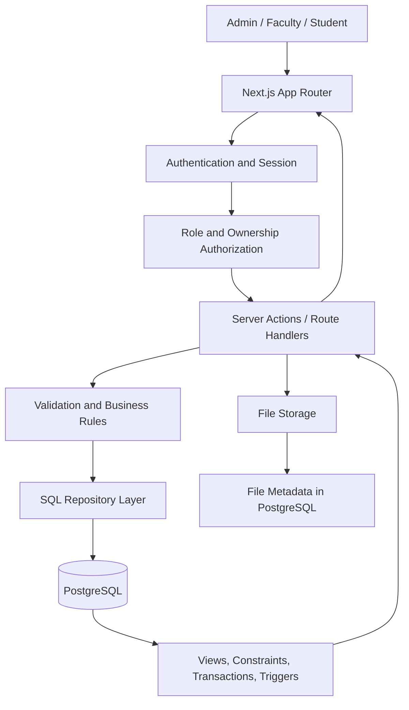
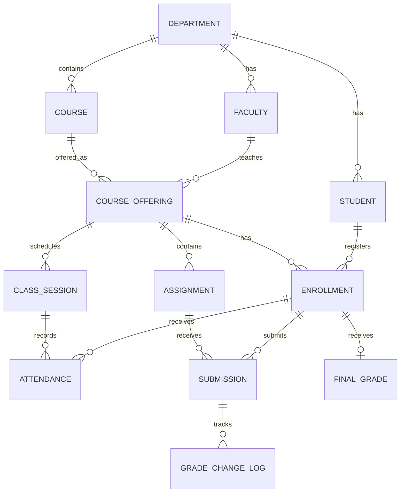

# System Architecture — Academic Course Management System

## 1. Purpose

The Academic Course Management System (ACMS) is a database-driven platform for a college or university. It centralizes department and course data, faculty assignments, student enrollments, class sessions, attendance, assignments, submissions, grading, and grade-change auditing.

The system has three role-based user experiences:

- **Admin:** manages institutional master data, accounts, course offerings, and enrollments.
- **Faculty:** manages class sessions, attendance, assignments, submissions, and marks for assigned offerings.
- **Student:** views enrolled courses, sessions, assignments, attendance, submissions, and final grades.

The implementation uses **Next.js** for the web application and **PostgreSQL** as the relational database. The application must be dynamic: pages read and write real database records rather than displaying hard-coded sample content.

## 2. Architecture decisions

| Layer | Technology | Responsibility |
|---|---|---|
| Web application | Next.js (App Router) + TypeScript | Pages, layouts, dashboards, forms, tables, and navigation |
| UI | React + Tailwind CSS + reusable components | Responsive presentation and interaction |
| Server/API | Next.js Route Handlers and server-side modules | Authentication checks, validation, business rules, and database operations |
| Database | PostgreSQL | Persistent relational data, constraints, transactions, views, and audit records |
| SQL access | `pg` (node-postgres) or a thin typed SQL repository layer | Parameterized SQL queries and transaction handling |
| File storage | Local development storage; configurable object storage for deployment | Stores assignment files; PostgreSQL stores file metadata and storage keys |
| Authentication | Auth.js or an equivalent session-based solution | Sign-in, session handling, and role-aware access |

**Database-first principle:** PostgreSQL is the source of truth. The UI must not calculate or invent authoritative attendance, submission lateness, audit history, or final-grade values independently of the database.

## 3. High-level architecture



### Request lifecycle

1. A user signs in and receives a server-managed session.
2. The requested page or mutation checks the user's role.
3. Server-side code validates the request and verifies record ownership or course assignment.
4. The SQL layer executes parameterized queries against PostgreSQL.
5. Related writes run in a transaction where consistency requires it.
6. PostgreSQL constraints and triggers enforce important integrity and audit rules.
7. The server returns the saved database result; the UI refreshes or revalidates the relevant data.

## 4. Suggested application structure

```text
acms/
├── app/
│   ├── (auth)/
│   │   └── login/
│   ├── (admin)/
│   │   └── admin/
│   │       ├── dashboard/
│   │       ├── departments/
│   │       ├── courses/
│   │       ├── users/
│   │       ├── offerings/
│   │       └── enrollments/
│   ├── (faculty)/
│   │   └── faculty/
│   │       ├── dashboard/
│   │       └── offerings/[offeringId]/
│   │           ├── sessions/
│   │           ├── attendance/
│   │           ├── assignments/
│   │           ├── submissions/
│   │           └── gradebook/
│   ├── (student)/
│   │   └── student/
│   │       ├── dashboard/
│   │       ├── courses/
│   │       ├── assignments/
│   │       ├── attendance/
│   │       └── grades/
│   ├── api/
│   │   └── ... route handlers when needed
│   ├── layout.tsx
│   └── page.tsx
├── components/
│   ├── layout/
│   ├── navigation/
│   ├── dashboard/
│   ├── data-display/
│   ├── forms/
│   └── ui/
├── lib/
│   ├── auth/
│   ├── db/
│   │   ├── pool.ts
│   │   ├── queries/
│   │   └── transactions/
│   ├── permissions/
│   ├── validation/
│   ├── grading/
│   └── files/
├── db/
│   ├── migrations/
│   ├── seeds/
│   ├── views/
│   └── functions/
├── types/
├── public/
└── docs/
    ├── architecture.md
    ├── DESIGN.md
    └── planning.md
```

Keep SQL out of client components. Database credentials and privileged queries must only be used on the server. Use parameterized SQL; never concatenate user input into SQL strings.

## 5. Relational data model

The following entities follow the supplied project specification. Names may be adjusted during schema implementation, but relationships and integrity rules should remain.

| Entity | Main purpose | Important relationships |
|---|---|---|
| `DEPARTMENT` | Institutional departments | Has courses, faculty, and students |
| `USER` / role-specific profile | Login identity and role | One account has a role; profile data is role-specific |
| `FACULTY` | Faculty profile | Belongs to a department |
| `STUDENT` | Student profile | Belongs to a department; has enrollments |
| `COURSE` | Course catalogue | Belongs to a department |
| `COURSE_OFFERING` | A course taught in a semester/year | References one course and exactly one faculty member |
| `ENROLLMENT` | Student registration in an offering | References one student and one offering |
| `CLASS_SESSION` | Scheduled class meeting | Belongs to one offering |
| `ATTENDANCE` | Student status for a session | References one session and one valid enrollment |
| `ASSIGNMENT` | Assessment definition | Belongs to one offering |
| `SUBMISSION` | Student's uploaded work and evaluation | References one assignment and one eligible student/enrollment |
| `GRADE_CHANGE_LOG` | History of mark changes | References the affected submission and actor |
| `FINAL_GRADE` | Computed or published result | Belongs to one enrollment |

### Relationship outline



### Important integrity rules

- A course offering must reference exactly one course, one faculty member, and one semester/year.
- A student must not have duplicate active enrollment in the same offering.
- A student can submit only to an assignment belonging to an offering in which they are actively enrolled.
- A session's attendance record must refer to an enrollment in that session's offering.
- Attendance should be unique per `(session_id, enrollment_id)`.
- A submission should be unique per `(assignment_id, enrollment_id)` unless resubmission/versioning is explicitly added.
- Marks must be within the assignment's allowed range.
- A change to an already-awarded mark must create an immutable audit entry containing old marks, new marks, actor, and timestamp.

## 6. Core dynamic workflows

### Admin workflow

1. Create or update departments, courses, faculty, and student accounts.
2. Create a course offering for a semester and academic year.
3. Assign one faculty member to the offering.
4. Enroll students and manage enrollment status.
5. View operational reports.

### Faculty workflow

1. Open an assigned course offering.
2. Create class sessions with date, start time, and topic.
3. Record attendance as `Present`, `Absent`, or `Excused`.
4. Create assignments with due date, maximum marks, and late-penalty percentage.
5. Review submissions and download the associated files.
6. Award marks; when an existing mark changes, write a grade-change audit record in the same database transaction.

### Student workflow

1. View current course offerings and enrollment details.
2. View upcoming class sessions and active assignments.
3. Upload an assignment file.
4. View submission timestamp and late status.
5. View attendance percentage and published final grade.

## 7. Database responsibilities and SQL features

The DBMS component should be visible and demonstrable, not hidden behind an ORM.

- **Primary and foreign keys:** identify records and enforce relationships.
- **Unique/check constraints:** prevent duplicate enrollment/attendance and invalid marks or percentages.
- **Transactions:** keep related operations atomic, especially grading and audit logging.
- **Trigger or database function:** record changes to previously graded submissions in `GRADE_CHANGE_LOG`.
- **Views:** provide reusable attendance percentage, attendance-deficit, and final-grade reporting queries.
- **Indexes:** support lookups by email, roll number, offering, student, assignment, and due date.
- **Parameterized queries:** protect against SQL injection.
- **Migrations and seed data:** make the schema reproducible and allow a reliable demo.

### Derived values

- `is_late` should be derived from `submitted_at > due_at` using the agreed deadline/time-zone rule. Prefer a generated query/view or server/database rule over a client-side flag.
- Attendance percentage should be calculated from eligible attendance statuses according to a documented policy. Decide whether `Excused` is excluded from the denominator before implementation.
- Final grade calculation must use a documented, faculty/admin-approved weighting policy. The supplied requirements mention weighted assessments and attendance but do not specify exact weights or grade boundaries; keep these configurable rather than inventing them.

## 8. Security and authorization

- Store password hashes, never plain-text passwords.
- Enforce authorization on the server for every protected page and mutation.
- Admins can manage institutional master data and offerings.
- Faculty can modify only offerings assigned to them.
- Students can access only their own profile, enrollments, attendance, submissions, and grades.
- Validate uploaded file type and size; generate safe storage names; do not trust a client-provided file path.
- Store file metadata in PostgreSQL, not file contents, unless the project explicitly chooses database blob storage.
- Keep secrets in environment variables and exclude `.env` files from version control.
- Use audit logs for sensitive grading changes; avoid silently overwriting history.

## 9. Deployment and environments

| Environment | Configuration |
|---|---|
| Local development | Next.js dev server + local PostgreSQL |
| Testing | Separate test database and deterministic seed data |
| Demo/production | Deployed Next.js app + managed PostgreSQL + persistent file storage |

Example environment variables (names only):

```env
DATABASE_URL=
AUTH_SECRET=
APP_BASE_URL=
FILE_STORAGE_PATH=
```

Do not commit real credentials. Apply database migrations before starting a new deployment.

## 10. Architecture acceptance criteria

- Every dashboard count and data table is loaded from PostgreSQL.
- Create, read, update, and permitted delete actions persist to the database.
- Role restrictions are checked server-side.
- Attendance and grade reports are computed from stored records.
- Late submissions are derived from the stored due and submission timestamps.
- Editing an existing awarded mark creates an audit record.
- Refreshing the page does not lose saved data.
- The app works with empty states and loading/error states, not only pre-filled demo data.
